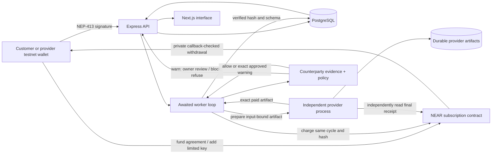

# Accord implementation architecture

Current implementation, updated 12 November 2026. Full repository/deployment context and audit: [PROJECT_HANDOFF.md](PROJECT_HANDOFF.md). Historical DAEMON_NEAR_* proposals in this directory are research alternatives, not the implemented money path.

The unreleased reliability extension adds explicit execution approval, frozen service criteria, independent prepayment evidence checks and one bounded local AI risk analyst. Its updated architecture, API, migrations and rollout boundaries are in [reliability/OPERATIONS.md](reliability/OPERATIONS.md); the diagram below describes the earlier deployed baseline.



## Agreement and payment flow

1. Provider signs `register_service`. Immutable onchain terms bind its account, exact price, interval and metadata hash. The API verifies that account owns the registration before publishing its metadata. Provider URLs are limited to the configured reference deployment.
2. Native NEAR customers prove wallet ownership with a five-minute one-use challenge, fixed site recipient and network. Ethereum-wallet accounts instead use the separate browser-bound finalized login-contract receipt described in [Ethereum wallets](ETHEREUM_WALLETS.md). `near-api-js/nep413` verifies the signature and the account's full-access public key. A hashed, expiring server-side session backs an HttpOnly SameSite cookie.
3. API generates a dedicated Ed25519 charge key. Only the public key reaches the browser; AES-256-GCM encrypts the limited private key at rest. Provisioning is tied to the authenticated account.
4. Customer approves a finite contract agreement, attaching exact service budget plus retained storage fee. A separate wallet action installs the charge-only key with a finite gas allowance. The API checks the finalized agreement, input hash, owner, public key and onchain permission before activating scheduling.
5. A PostgreSQL session advisory lock serializes workers per subscription. A partial unique index permits only one unresolved cycle. The provider binds preparation to the subscription input hash and due cycle. Its artifact and preparation capability are persisted before any charge. AI preparation, when enabled, additionally has a persistent request cap and a fail-closed review state; it cannot silently fall back.
6. Worker persists the original cycle/hash and calls the mandatory counterparty service for the escrow and economic provider. A block refuses signing; a warning requires an authenticated, expiring, exact-payment approval. Evidence is refreshed and approval consumed once before key decryption. Only then does it request `charge` using the restricted key and independently read the final contract receipt. The contract gets recipient and amount from its immutable service and checks owner/signer/key, active state, expiry, due time and exact next cycle. No catch-up billing occurs.
7. Provider independently checks the same contract receipt against the frozen artifact, provider, amount and preparation capability. The worker verifies schema and SHA-256 before storing a delivered report. A later cycle cannot proceed while delivery/payment remains unresolved.
8. Wallet cancellation atomically disables future contract charges and moves unspent reserve to the customer's available ledger. Previously paid artifacts remain retrievable. Removing the access key separately revokes its residual gas authority.
9. Customer/provider withdrawals debit their source ledger before the native transfer. One pending withdrawal per account prevents overlap. The private callback restores the ledger on transfer failure. Direct wallet calls preserve the exit path when the API is unavailable.

```mermaid
sequenceDiagram
  participant Owner as Customer wallet
  participant API
  participant Worker
  participant Provider
  participant NEAR
  Owner->>API: Sign one-use NEP-413 challenge
  Owner->>NEAR: Fund finite agreement
  Owner->>NEAR: Add charge-only key
  API->>NEAR: Verify final agreement and access key
  loop Each due cycle, at most max_cycles
    Worker->>Provider: Prepare agreed input
    Provider-->>Worker: Frozen artifact hash and capability
    Worker->>API: Check counterparties; pause block/warn
    opt Warning requires owner review
      API-->>Owner: Exact intent and evidence
      Owner->>API: Approve once or decline
      Worker->>API: Refresh evidence; consume approval
    end
    Worker->>NEAR: Only allowed/approved charge(subscription, cycle, same hash)
    Worker->>NEAR: Read final receipt
    Provider->>NEAR: Independently verify payment credit
    Provider-->>Worker: Exact paid artifact
    Worker->>API: Store delivered report after schema/hash verification
  end
  Owner->>NEAR: Cancel; release unspent reserve
  Owner->>NEAR: Remove limited key
  Owner->>NEAR: Withdraw remainder
  NEAR-->>Owner: Native transfer and checked callback
```

## Recovery invariants

Database states are PREPARING, PREPARED, SUBMITTING, UNCERTAIN, SETTLED and DELIVERED. A transport error does not establish that no charge occurred. The frozen contract cycle/hash remains the only retry body. The contract makes duplicate logical billing idempotent even when SDK nonce retries create another transaction.

PREPARED/SUBMITTING/UNCERTAIN recovery reads the final receipt first. SETTLED recovery retrieves the same artifact without another payment. Delivery failures retain payment evidence. DELIVERED cannot regress under a late worker update. Database leases improve scheduling availability; the contract cycle/hash and database constraints form the monetary fence when a process or connection fails.

The provider's preparation record is inserted before optional inference. A crash or opaque inference timeout leaves a review state rather than automatically consuming credits again. Prepared artifacts never regenerate under the same cycle after their hash has been exposed.

## Why this design

The user's testnet-only policy excludes Agent API/Intents, which are mainnet-only. Application-only timing would leave a malicious dispatcher able to spend too early despite an aggregate policy cap. The native contract enforces those exact commercial limits. Function-call keys restrict invocation independently of contract bookkeeping.

The tradeoffs are contract custody of prepaid native NEAR, retained storage fees and contract/deployment risk. Gas allowance is not the subscription budget. Native NEAR prices are not stablecoin prices. There is no bridge, arbitrary destination list, auto-top-up, platform fee or separate charge for the scheduler.

Per-request payment protocols can make sense for occasional HTTP purchases. Accord's missing primitive is a reusable, finite recurring mandate with exact timing and a direct exit. A generic escrow or agreement hash without enforcement on the actual charge path would not provide that guarantee.

## Trust and current limits

The owner trusts the deployment account not to replace code or transfer contract funds; full-access development keys remain. Provider work quality is not enforced by a hash. The API/provider see portfolio inputs; optional TEE inference does not make the whole application private. The deterministic reference analyzes a supplied snapshot, so an unchanged snapshot yields repeated information. Customer validation, refreshed holdings and broader provider discovery remain future product work.

The current deployment has one approved provider endpoint and a shared development PostgreSQL instance for API/provider tables. Processes are independently hosted and the provider verifies settlement directly. Separate provider databases/credentials are a production hardening step, not an implemented decentralization claim.

## Live agent services

The requested expansion adds five distinct RPC-backed handlers in `backend/src/near/agents.ts`: wallet reserve, public-key permissions, deployed-code baseline, finalized-transaction diagnostics and RPC health. A registry supplies validated input schemas to the API/provider and marketplace forms. The existing contract needs no redeployment: its immutable metadata hash binds the service type, and its price/recipient/cycle restrictions remain the actual charge path. The worker checks expected report kind and bounded schema before delivery.

Public demonstrations come only from explicitly published developer-fixture rows in `accord_agent_demos`; customer subscriptions and reports remain session-owned. Each example is labeled with its recorded time rather than presented as a newly generated free result. See AGENT_SERVICES.md for service IDs, run commands and live transaction evidence.

## Application operations extension

`operations.ts` captures code identity and public access-key permissions at one finalized block, with freshness and account-scope bounds. `workspaces.ts` owns wallet-private application scope and exact-hash, expiring baseline approval. `incidents.ts` compares canonical authority shapes while ignoring routine gas-allowance consumption; it groups observations, resolves/reopens conditions and atomically inserts timeline and notification records. Baseline reapproval never erases history.

`operations-worker.ts` polls enabled workspaces sequentially and dispatches `notifications.ts` outbox records under leases and bounded retries. Optional external delivery is operator-configured HTTPS plus HMAC, explicitly enabled per workspace. Stable event IDs support receiver deduplication; acceptance is not human acknowledgement. In-app-only operation explicitly cannot notify a closed app. `/ready` checks DB and recent worker completion; an external uptime monitor is still necessary.

`evidence.ts` exposes owner-scoped cursor pagination and consistent, bounded JSON exports with reproducible digests. `workspace-reports.ts` rechecks separately purchased artifacts against final onchain receipts and account association before linking them. The existing billing contract, reserved funds, cancellation and withdrawal logic are unchanged. Pilot observations do not debit NEAR and are not represented as paid receipts. Groq explanations are optional, capped, cached and advisory; they never alter deterministic findings or sign actions.

`pilot-metrics.ts` reports wallet-private setup/review counts excluding marked demos. Neither a wallet count nor self-reported continuation terms constitute customer validation or revenue. Deletion cascades pilot records only; independent paid agreements and chain history remain.

## Counterparty trust boundary

See [COUNTERPARTY_SECURITY.md](COUNTERPARTY_SECURITY.md) for sources, policy and endpoints. This gate runs in the backend; it is not an on-chain reputation attestation. Compromised dispatcher/deployer, curated-report trust, incomplete history, code-change polling and repeated young-account warnings remain documented limits. The financial contract still enforces its separate limits. [The handoff](PROJECT_HANDOFF.md) explicitly distinguishes the present adversarial-output test from a complete prompt-injected-agent demonstration.
