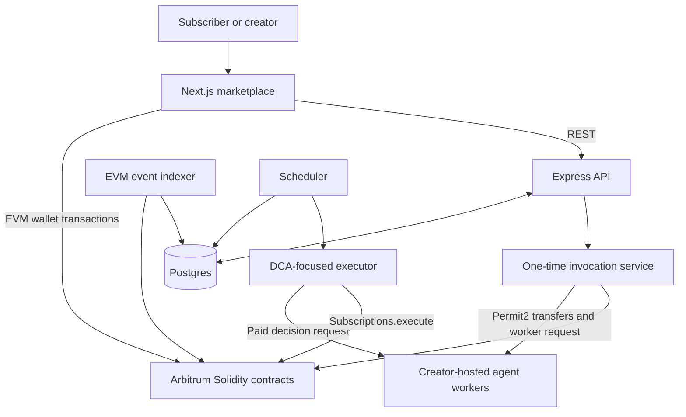
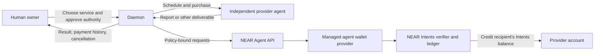
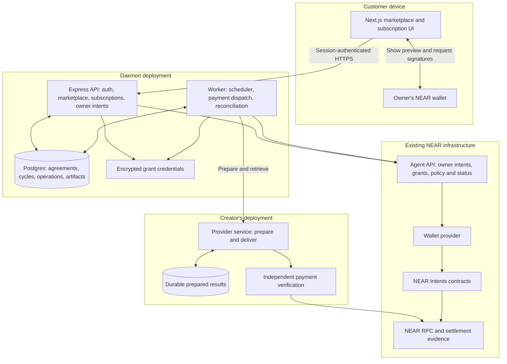
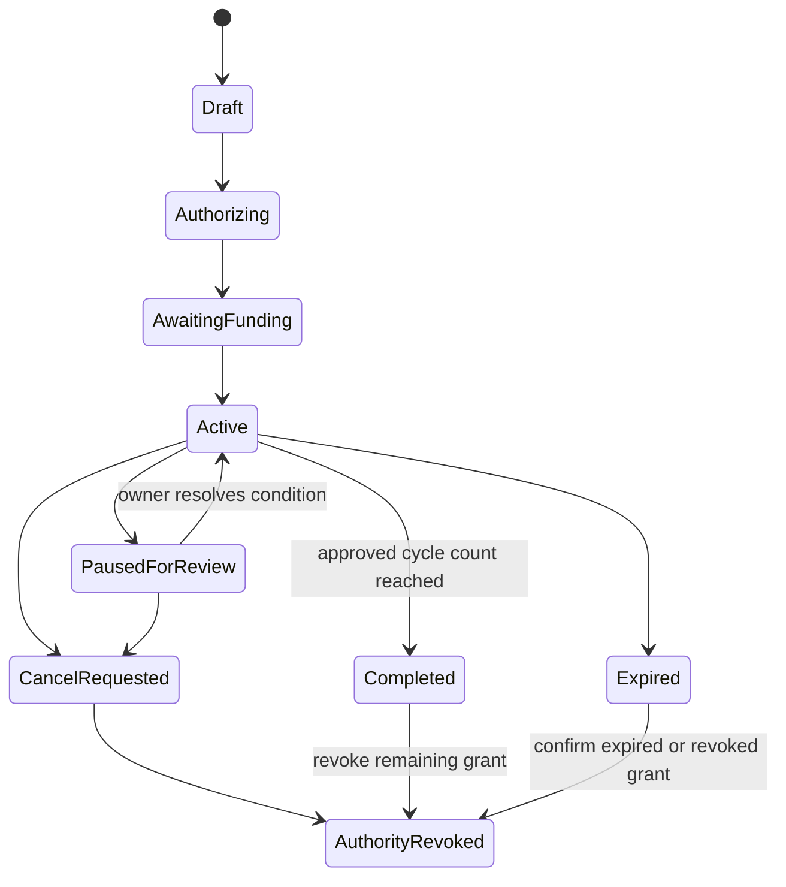
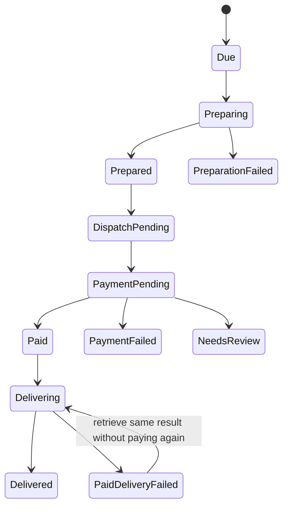

# Daemon on NEAR — architecture, implementation design, and complete flows

**Design date:** 10 November 2026, India time  
**Source baseline:** `web3cook/Daemon`, `main`, `2eeed81fc3cec1dafbd277f2dccea8909247455d`  
**Status:** Proposed architecture. No new application code, funded transaction, grant, policy, or deployment has been executed as part of this document.

## 1. The product and the architecture decision

Daemon remains a marketplace where humans and software buy useful agent services. Its NEAR version adds **recurring service purchases with owner-approved spending rules, reliable payment tracking, delivery records, and cancellation**.

The reference flow is deliberately close to the existing product: a customer subscribes to the existing portfolio-risk agent for one report per day. A customer-side purchasing worker buys that service on schedule. The provider runs independently and receives payment into its own NEAR Intents account. A report is an illustrative service, not a validated business opportunity or a commitment to become an account-monitoring product.

**Default implementation: use the existing NEAR Agent API and NEAR Intents settlement infrastructure. Do not build a new wallet, escrow contract, NFT identity system, bridge, or solver for v1.** Daemon implements the subscription and delivery application around those components.

This replaces the earlier readiness document's contract-first default. The previous native-testnet escrow design remains an alternative, not an additional subsystem to implement. It is justified only if a mandatory requirement cannot be expressed by the existing infrastructure, or a complete testnet-only payment deployment becomes a hard requirement.

The tradeoff must remain visible: the recommended Agent API is an experimental, mainnet-only service. There is no Agent API testnet. A local simulated run can test the application, but cannot establish that real NEAR payments work. A live integration requires a small explicitly approved funding exercise later. No funding is authorized by this document. [N1]

### What this design does and does not guarantee

| Capability | Who provides it? | Important boundary |
| --- | --- | --- |
| Discover and price services | Daemon marketplace | A listing is not proof of service quality |
| Agree price, interval, expiry and deliverable | Daemon, with the owner's signed agreement | The agreement is application data; not an independently executing billing contract |
| Approve spending permissions | Owner signatures through Agent API | Login and spending approval are separate actions |
| Restrict asset, destination, transaction amount and spending windows | Agent API and its wallet provider | Some controls run in the API; do not describe every control as onchain |
| Perform a scheduled purchase | Daemon worker | The worker must be running |
| Prevent duplicate submission of the same payment | Persistent Daemon attempt plus Agent API idempotency | A new key, grant or operation may create a new payment |
| Settle payment | Existing NEAR Intents contracts | Recipient credit inside Intents is different from withdrawal to an external wallet |
| Prove which output was purchased | Prepared artifact, hashes, provider receipt and settlement proof | A hash binds content; it does not prove accuracy or usefulness |
| Stop future delegated spending | Owner revokes the subscription's grant | Already committed executions cannot be recalled |
| Reverse a bad-service purchase | Provider refund process | There is no automatic offchain-work dispute arbitration in this v1 |

The meaningful addition is the complete recurring-service relationship. It is not a claim that NEAR lacks wallets or that x402 cannot automate purchases.

## 2. Current Daemon architecture, as implemented



The current layers are worth retaining:

| Layer | Existing implementation | What it currently assumes |
| --- | --- | --- |
| Marketplace UI | `frontend/app`, shared components and API hooks | EVM wallets, service contracts and Arbitrum addresses |
| Public/creator API | Express routers | EVM identity strings and existing subscription records |
| Persistence | Postgres schema | USDC-denominated values, EVM contract IDs and mostly combined run/payment state |
| Scheduler | Interval loop querying subscriptions | May overlap ticks; database status identifies work to attempt |
| Executor | Reads subscription, buys a DCA decision, submits swap execution | Hardcoded DCA-oriented output/route concepts |
| One-time invocation | Permit2 allowance registration and payment splitting, then a paid worker call | Multiple payment steps and a platform signer |
| Chain indexer | EVM log polling | Solidity events and ABIs |
| Worker | Express service plus inference/data collection | Custom 402/allowance payment implementation |
| Smart contracts | Subscription terms, Permit2 spending, per-service revenue, identity | EVM execution and token standards |

Source references: [B1]–[B9]. This is a code-based map, not simply the README diagram. In particular, the current scheduled executor is not yet a generic service runner, and the current worker payment flow should not be described as verified standard x402.

## 3. Proposed system context



The customer wallet retains its owner signing authority. Daemon receives a revocable grant to operate within an approved policy; it does not receive the owner's private key. Funds are held within the existing wallet/Intents infrastructure, not a new Daemon balance pool. This is still a dependency on the wallet provider, Agent API and Intents contracts—not a claim of risk-free custody. [N1][N2]

The analyzed portfolio may remain on Arbitrum while service payments settle through NEAR. **The address being analyzed, the human's signing account, the buyer agent wallet, and the provider's payment account are four different identities.** They must not be interchanged.

## 4. Container and deployment architecture



For v1, run one API container, one worker container and Postgres 16. The provider runs separately. One worker process contains scheduling and reconciliation loops; these need separate responsibilities, not separate microservices. Start with database-backed leases rather than adding Redis or a new queue dependency. Reuse the existing Next.js/Express stack and standardize Node on version 24, which the current Agent API SDK requires.

Do not run the old EVM indexer/executor or expose legacy write routes in the NEAR demonstration deployment. Preserve their code and configuration for the Arbitrum baseline. Give the new mode its own explicit Compose profile/configuration.

## 5. The reference service and exact billing semantics

### Customer example

> “Ask this portfolio-analysis agent for one fresh report every 24 hours. Pay one unit of the selected supported stablecoin per report. Make at most three purchases, expire the authorization after 72 hours, and let me stop it.”

The amounts are illustrative fixture terms, not recommended pricing or permission to spend money. Resolve the precise supported token's asset ID and decimals from the live token catalog. One USDC representation is not interchangeable with every other token named USDC.

The provider's report can reuse the current risk analyzer's holdings collection and concentration assessment. It must distinguish observations from interpretation. Do not claim the existing analyzer detects scams or controls the customer's investment portfolio. Inference may be replaced by a deterministic fallback during local tests; the UI labels that mode. [B9]

### v1 rules

- A subscription purchases one deliverable per completed billing cycle; it does not grant unlimited API calls.
- The first cycle is eligible when setup and funding are complete.
- After a successful payment, the next new purchase cannot occur earlier than that settlement time plus 24 hours. Missed periods are not back-billed.
- There is only one unresolved monetary cycle per subscription.
- Price, asset, provider recipient, input configuration and output schema are versioned in the signed agreement. Changing them needs new owner approval.
- The normal application stops after three successful purchases or at expiry. The grant also has a finite expiry.
- The provider prepares a result before payment and keeps it retrievable after payment. A completed purchase is not reversed just because the subscription is later canceled.
- No platform fee or revenue split in this NEAR v1. The customer makes one service payment to the provider; do not retain the legacy platform-then-worker payment pattern.

**These rules have different enforcement locations.** The strict cycle count and timing are Daemon application checks. NEAR policy limits independently constrain spending within their supported windows. A compromised Daemon dispatcher could attempt extra payments to the approved provider within those limits. If exact per-cycle rules must remain enforceable against a fully malicious dispatcher, this API-only architecture does not meet that requirement; a separate onchain billing authorization design would be needed.

## 6. Identity, policy and grant model

### 6.1 One wallet per subscription in v1

Create one Agent API agent wallet for each subscription. Issue one active Daemon billing grant for that wallet. This is intentionally more isolated than using one customer wallet for every service.

Grants identify who may act; **they do not each carry independent permissions or budgets.** Policies and budgets belong to the agent wallet and are shared across all its grants. A grant per subscription within one shared wallet would not create per-subscription spending isolation. [N2][N3]

Store the customer's owner account, Daemon subscription ID, Agent API agent ID, actual NEAR Intents account ID, policy revision, grant ID and encrypted grant token separately. Provider registration likewise stores the actual intended Intents recipient, proven by its owner; it is not inferred from a display name.

The wallet-per-subscription approach costs additional setup and may encounter partner/sponsor quotas. Verify those in the first integration spike. A shared-wallet design is a later optimization requiring a clear explanation of shared exposure, not an invisible change.

### 6.2 Policy for the reference daily report

Proposed application settings, serialized into the documented full policy after resolving the asset:

| Policy field | Choice | Why |
| --- | --- | --- |
| Allowed actions | `transfer` only | Buying a report needs no trading or external withdrawal capability |
| Asset list | One exact resolved stablecoin asset ID | Prevent substitution with a different asset |
| Destinations | `only`: one public transfer recipient, the provider's Intents account | A compromised worker cannot redirect spending elsewhere |
| Per-transaction limit | One agreed report price in atomic units | Cap an individual purchase |
| Hourly asset limit | One report price | Limit bursts |
| Daily asset limit | One report price | Independently bound spending over the API's documented rolling daily window |
| Monthly asset limit | Three report prices | Bound aggregate token spend over the short reference grant's lifetime, provided policy/usage history is not reset |
| Maximum actions per hour | `1` | Additional protection against an accidental dispatch loop |
| USD-budget fields | Explicitly `null` in v1 | Atomic asset caps avoid adding an unnecessary price-feed dependency; do not advertise a configured USD cap |
| Native signing | Omitted/off | No arbitrary native transactions or signing escape route |
| Confidential mode | `false` | Public evidence is simpler to verify for the first release |
| Timelock | `0` for v1 | Avoid another payment queue; owner revocation still cannot recall committed actions |
| Per-action owner approval | `false` for normal billing | The customer already approves limited unattended operation |
| Grant expiry | At most the signed subscription expiry | Do not leave indefinite delegated authority |

These are design choices, not a live policy. The policy must be read back as `APPLIED` with provider synchronization confirmed before activation. The API and provider enforce different layers; do not call all of the above independent onchain contract rules. Normal owners may deliberately change their own rules; Daemon cannot silently sign a policy increase. [N3]

### 6.3 The maximum-loss statement

A stolen grant plus a usable partner key permits actions within the wallet's policy. It does not mean no money can be lost. For the reference configuration, exposure is constrained by the configured token-window caps, grant lifetime, available wallet funds, and provider-only destination. A malicious provider can still deliver poor work, and an approved recipient can receive unwanted in-policy payments. Price or policy changes need owner signatures.

Do not treat a resettable USD budget as an eternal spending cap. Token-window limits, calendar budget resets and the subscription's own cycle counter are different concepts. Provision no automatic top-up in v1.

## 7. Complete flow A — provider registration

1. The creator signs into Daemon with a verified NEAR wallet challenge and session.
2. The creator registers the agent's description, fixed HTTPS endpoint, input/output schema, exact payment asset, report price, interval and recipient account.
3. The creator proves control of the claimed provider payment account. For a named NEAR owner, use a domain-bound signed registration statement and verify its onchain key authority. Keep the provider's signing account distinct from a managed wallet account unless an explicit owner binding is verified.
4. The provider exposes a versioned service manifest and signing public key for prepared offers/results.
5. Daemon confirms the manifest matches the registration, checks that the named recipient exists, and stores a terms hash.
6. The listing becomes active after an operator review in the hackathon version. Open arbitrary URL onboarding is deferred until SSRF, redirect and DNS-rebinding protections are implemented.

No `ServiceFactory` deployment or ERC-8004 mint is required for the NEAR listing. The database remains a discovery registry; it is not a chain-verified quality or reputation system.

## 8. Complete flow B — subscription setup and funding

```mermaid
sequenceDiagram
    participant U as Owner wallet and UI
    participant D as Daemon API
    participant DB as Postgres
    participant A as Agent API
    participant L as NEAR Intents ledger

    U->>D: Select provider, immutable terms and inputs
    D->>DB: Save draft and exact agreement payload
    D->>A: Generate agent_create with restricted policy
    A-->>D: Signing standard, payload, preview, correlation ID
    D-->>U: Display exact preview
    U->>D: Sign returned payload using requested standard
    D->>A: submit-intent, then status
    A-->>D: Agent active and policy applied
    D->>DB: Generate and encrypt billing grant token
    D->>A: Generate grant_issue with token commitment
    D-->>U: Grant preview and separate agreement approval
    U->>D: Sign approvals
    D->>A: Submit grant; wait for success
    D->>A: Request deposit address
    A-->>U: Address, asset, minimum, memo and expiry
    U->>L: Owner-approved funding via returned route
    D->>A: Poll deposit and balance
    D->>DB: Activate only after all prerequisites pass
```

Owner spending setup uses the standard the API returns, not a hardcoded NEP-413 assumption: some operations require NEP-366 delegate-action signing, others NEP-413 message signing. Keep payloads unchanged between generation and wallet signing. The official API setup includes separate create and grant approvals; Daemon's commercial agreement approval is an additional application record, not a replacement for those signatures. [N4]

Generate grant credentials server-side, encrypt them at rest and send only the commitment in the owner-intent flow. The grant token and partner API key never go to the browser, provider, model prompt or logs. [N2]

Funding follows the deposit response, including its minimum amount, memo, destination asset and deadline. The application never invents an address, treats a correlation ID as an address, or assumes sending funds guarantees credit. Wait for settled deposit status and usable balance. There may be route minimums or fees; use the actual response, not an invented “one cent demo.” [N5]

Activation requires: verified owner/session; signed immutable agreement; matched provider terms; active agent wallet; synchronized policy; live grant; supported token metadata; sufficient settled funding; and a working result-verification path.

### Signed agreement contents

The owner approves the canonical serialized payload containing domain/network, owner, subscription ID, provider recipient, provider ID, terms/schema version, asset ID, atomic price, interval, maximum cycles, expiry, input hash and refund/delivery policy. Store the exact signed bytes and signature verification evidence. Use a fixed field order and decimal-string integers; do not hash arbitrary JSON objects with different property ordering.

This is evidence of consent and a guard for the honest application. The Agent API does not interpret Daemon's agreement hash as an onchain subscription contract.

## 9. Complete flow C — one recurring purchase

```mermaid
sequenceDiagram
    participant S as Scheduler and dispatcher
    participant DB as Postgres
    participant P as Provider agent
    participant A as Agent API
    participant N as NEAR Intents
    participant V as Provider proof verifier

    S->>DB: Lease one due cycle; freeze payment and result inputs
    S->>P: Prepare result for agreement and cycle
    P-->>S: Signed ready offer and stored output hash
    S->>S: Check terms, freshness, schema and expiry
    S->>DB: Persist attempt ID, grant ID, exact body and idempotency key
    S->>A: Transfer fixed asset and amount to fixed provider
    A->>A: Validate grant, policy, destination, rate and spending caps
    A->>N: Authorized transfer through wallet infrastructure
    A-->>S: Correlation ID and current status
    S->>A: Follow same operation to final evidence
    S->>P: Retrieve prepared result with settlement proof reference
    P->>V: Verify actual settled transfer and prevent receipt reuse
    V->>N: Read final execution evidence
    P-->>S: Exact stored result and provider receipt
    S->>DB: Record delivered artifact and payment evidence separately
```

### 9.1 Worker responsibilities

The scheduler selects due subscriptions. The dispatcher owns the immutable purchase attempt and writes to Agent API. The reconciler follows unfinished operations after restarts. These can be three modules in one worker process.

Before any network write, persist an operation record with the exact request body and idempotency key. The grant ID is part of its identity: the API scopes idempotency to a grant, so retrying under a replacement grant is not equivalent to retrying the original payment. One unresolved cycle blocks later cycles even if a database lease expires. [N6]

Use a database lease plus a fencing/generation value for application work. Only the current lease owner can transition a cycle or create its next attempt. Unique constraints prevent duplicate cycle/attempt creation. These measures protect normal retries; they are not a defense against a deliberately malicious database administrator or dispatcher.

### 9.2 Provider preparation

`POST /v1/prepare` returns a bounded, provider-signed offer containing the agreement hash, cycle ID, actual payer Intents account, provider recipient, asset ID, amount, output hash, artifact ID, preparation time, quote expiry, schema version and retrieval policy.

The provider does the work and durably stores it before advertising “ready.” Preparation can fail without taking payment. Rate-limit unpaid preparations, bound inputs, and reuse artifacts for identical inputs where appropriate. This shifts some unpaid-compute risk to the provider; a seller of very expensive fresh compute may need a different commercial model later.

The report must remain retrievable long enough to reconcile a paid operation and through hackathon judging. Provider signatures bind the offer/result to that provider; they do not certify subjective quality or prove an inference ran in a TEE.

### 9.3 Settlement destination

The initial payment is an internal public transfer between NEAR Intents accounts in the same selected asset. It does not need a cross-chain swap every day. The existing verifier contract moves ledger balances. A creator can withdraw earnings later using the supported infrastructure. [N7]

Money path:

```text
Customer's external wallet
    -> approved funding route
    -> subscription-specific balance in NEAR Intents
    -> policy-authorized transfer for one cycle
    -> provider's balance in NEAR Intents
    -> optional provider-controlled withdrawal later
```

There is no intermediate Daemon fee wallet in the v1 payment path. Funding and withdrawals may involve conversion/bridging; the recurring internal transfer itself should not be described as a fresh bridge operation.

### 9.4 Provider verification and replay protection

An Agent API `correlation_id` is an operational lookup handle, not self-authenticating proof. A provider cannot assume its own tenant key can read another customer's Agent API operation. It must verify the underlying public NEAR settlement evidence, not trust a JSON `SUCCESS` object supplied by Daemon.

The proof package includes the intent hash and a resolvable NEAR transaction/receipt reference. When needed, the documented Message Bus `get_status` can resolve an intent hash to a NEAR transaction hash, but that service requires a **separate Intents Partner JWT**, not the Agent API's opaque partner key. A hash produced by an execution path not indexed there may not resolve. Prefer a directly returned valid transaction reference when available; establish one supported resolution path in the integration spike. [N8]

The provider checks final execution outcome, actual verifier contract, payer Intents account, recipient, exact asset and amount, and the relevant executed-intent/transfer event. Parse the pinned event schema, not a balance delta or explorer screenshot. A batched transaction may contain several intents: identify the exact intent and transfer, not just the transaction hash. Verifier events document the relevant execution and ledger changes. [N9]

Public transfer requests do not automatically include Daemon's agreement/output hash onchain. The binding between a transfer and an artifact is the provider's signed offer plus its own persisted proof-consumption record. Match the payer, recipient, asset, amount and freshness to the offer. Consume the **whole payment intent** for one prepared purchase in v1, so a different transfer index cannot spend the same payment receipt again. Reject unsupported/batched shapes until their uniqueness rules are implemented.

Use a unique settlement-consumption record at the provider. Retrying the same proof for the same artifact returns the original result; presenting it for a different artifact fails. This design binds commerce records and chain evidence, but does not make offchain delivery atomic with payment.

**Release blocker:** if the actual funded Agent API transfer cannot be resolved to independently checkable evidence, do not label provider delivery independently verified. Resolve that capability gap before enabling paid service access; do not substitute trust in Daemon's status endpoint without disclosing a changed trust model.

## 10. Complete flow D — cancellation, revocation and exit

```mermaid
sequenceDiagram
    participant U as Owner
    participant D as Daemon
    participant DB as Postgres
    participant A as Agent API

    U->>D: Cancel subscription
    D->>DB: Mark cancel_requested and stop new cycle admission
    D->>A: Generate grant_revoke for this subscription's billing grant
    D-->>U: Display revocation preview and signing payload
    U->>D: Sign with owner wallet
    D->>A: Submit and wait for confirmed revoke
    A-->>D: Revoked plus any already committed operation IDs
    D->>DB: Mark authority revoked and reconcile in-flight operations
    D-->>U: Future billing stopped; show outstanding outcomes separately
```

Local cancellation stops the honest scheduler immediately. **Effective authority revocation is a separate owner-approved operation.** Do not show “spending access revoked” just because a database flag changed.

Revocation blocks future/not-yet-committed executions, but it cannot recall a payment past the API's dispatch commitment. Cancellation must show those operations until their outcomes are known. A paid result remains retrievable after cancellation. The published API exposes committed-operation references in the revoke result. [N2][N6]

Funds remaining in the subscription wallet are not automatically returned when a grant is revoked. Exiting requires an owner-approved wallet policy/withdrawal flow: revoke the billing grant, reconcile all operations, authorize withdrawal only to the owner's verified address, use a short-lived exit grant with per-action owner approval, withdraw the settled available balance, and revoke that exit grant. Do not silently give the old billing worker withdrawal authority. Prototype this complete path before taking live service payments.

The Agent API, wallet provider and owner-signing tools remain dependencies for managed-wallet exit. An independently usable owner dashboard or recovery procedure must be verified; do not promise permissionless direct withdrawal from Daemon's own contract, because no such contract exists here. If independent exit is a mandatory customer requirement and cannot be demonstrated, reassess the wallet choice.

## 11. State machines and failure handling

### 11.1 Subscription state



Keep service status and authority status as separate fields. “Completed” in Daemon does not itself revoke an unexpired grant. Stop the scheduler, request revocation, and record whether the owner has completed it. Grant expiry is an external backstop; policy-window limits are another backstop.

### 11.2 Billing cycle state



Never collapse these into a single `success` Boolean. A payment may succeed while delivery fails. A report may be prepared without any payment. An operation may remain unresolved while a subscription is being canceled.

### 11.3 External status mapping

| Agent API state | Daemon action |
| --- | --- |
| `PROCESSING`, `QUEUED`, `UNCERTAIN` | Keep operation pending; reconcile the same correlation ID and original grant/key/body |
| `PENDING_APPROVAL`, `PENDING_SIGNATURE` | Show owner action required; do not generate alternative spend requests |
| `SUCCESS` | Validate evidence against the frozen expected request; then attempt delivery |
| `NEEDS_REVIEW` | Suspend automatic work and request review; do not poll indefinitely as if it will resolve itself |
| `FAILED`, `REFUNDED` | Inspect reason, execution evidence and balances; do not assume no funds moved or automatically create a new payment |
| Transport timeout or server error | Preserve unknown outcome; retry only the identical request under its original idempotency key |

After review, the documented status refresh observes the original operation again. A new idempotency key is permitted only for genuinely new work after a proved non-execution or explicit reviewed recovery; it is not a timeout remedy. [N10]

### Failure policy

- Preparation failure: no charge, bounded retry, then pause with an explanation.
- Wrong price/destination/asset: reject before dispatch and retain an audit record; the external policy supplies an additional check.
- Payment unknown: block future cycles, retain reserved expected cost in Daemon's accounting, and reconcile.
- Payment successful but provider unavailable: retry retrieval for the existing artifact; never pay again for that cycle.
- Delivery invalid: mark paid-delivery failure, stop new automatic purchases, provide evidence and the provider's disclosed refund route.
- Grant revoked/expired or policy unavailable: stop; never fall back to a full-access key or a different grant.
- Provider refund: separate incoming operation and receipt; do not rewrite the original payment as if it never happened. A routing refund is not a refund for poor service.

## 12. Data model and API changes

### 12.1 Additive tables

Use a fresh development database and versioned migrations. The existing schema contains destructive legacy cleanup; do not reuse it blindly on an existing database. Do not overwrite Arbitrum rows. [B6]

| Table | Key fields |
| --- | --- |
| `near_identities` | user ID, verified owner account, network, session/auth evidence |
| `near_provider_services` | creator, service ID, endpoint, recipient Intents account, manifest/schema hashes, price/asset, signing public key |
| `near_subscriptions` | owner, provider, immutable agreement/hash/signature, interval, max cycles, expiry, status, next due, lease generation |
| `near_agent_bindings` | subscription, Agent API agent ID, Intents account ID, owner, policy revision/hash/status |
| `near_grants` | subscription, grant ID, encrypted credential reference, expiry, revocation status |
| `near_cycles` | subscription, sequence, agreement version, input hash, artifact/offer hash, delivery state |
| `near_payment_attempts` | cycle, attempt number, original grant ID, idempotency key, exact body/body hash, correlation ID, dispatch commitment, status/evidence |
| `near_owner_intents` | owner, allowed intent type, correlation ID, generated payload hash, expiry, result |
| `near_artifacts` | provider, artifact ID, content hash, immutable stored content/object reference, retention, retrieval receipt |

Store atomic amounts as validated decimal strings or sufficiently sized exact numeric columns; use `bigint` in application arithmetic. Do not reuse six-decimal USDC columns for arbitrary token units or NEAR amounts.

Required uniqueness:

```sql
-- Proposed constraints, not migrations already installed.
UNIQUE (subscription_id, cycle_sequence)
UNIQUE (cycle_id, attempt_number)
UNIQUE (grant_id, idempotency_key)
UNIQUE (correlation_id)
UNIQUE (network, verifier_contract, intent_hash) -- at the provider's proof consumer
```

Allow multiple historical failed attempts only through an explicit retry decision. Permit at most one unresolved attempt for a cycle. Do not resend an unresolved attempt under a replacement grant. Index due subscriptions and unresolved correlations; bounded queues are enough for v1.

### 12.2 Daemon HTTP surface

All paths below are proposed application routes under `/api/near/v1`; they are not Agent API endpoints.

| Route | Purpose |
| --- | --- |
| `POST /auth/challenge`, `/auth/verify` | Domain-bound wallet authentication and a real server session |
| `GET /services`, `GET /services/:id` | Marketplace discovery and immutable term versions |
| `POST /providers/services` | Authenticated creator registration with recipient-ownership verification |
| `POST /subscriptions` | Create a draft agreement; derive owner from session |
| `POST /subscriptions/:id/setup-intent` | Generate only an allowed setup/policy/grant intent for this owner |
| `POST /owner-intents/:id/submit` | Submit a wallet result tied to the stored intent and owner |
| `POST /subscriptions/:id/deposit` | Request one tracked funding route |
| `GET /subscriptions/:id` | Effective state, policy, grant, funding and next run |
| `GET /subscriptions/:id/cycles` | Payment and delivery history |
| `POST /subscriptions/:id/cancel` | Stop local admission and start owner-approved grant revocation |
| `POST /subscriptions/:id/exit-intent` | Prepare the separately approved owner exit flow |
| `GET /operations/:id` | Session-authorized normalized status; never raw credentials |

No public route accepts arbitrary recipient, asset, grant token and amount as a generic spend command. The dispatcher constructs payment exclusively from persisted approved terms. A valid session does not permit editing another user's subscription or submitting their correlation ID. [N4][N11]

### 12.3 Provider HTTP surface

| Route | Purpose |
| --- | --- |
| `GET /v1/service` | Versioned manifest, provider identity, schemas and terms |
| `POST /v1/prepare` | Bounded inputs plus agreement/cycle; returns signed prepared offer |
| `POST /v1/deliver` | Offer/artifact ID plus verifiable payment reference; duplicate-safe delivery |
| `GET /health` | Availability without exposing secrets |

This is a Daemon provider protocol. Do not call it x402 until standard x402 interoperability is implemented and tested. In a later version, standard x402 may wrap one-time purchases or subscription access; it need not be replaced by a proprietary HTTP-402 imitation. [N12]

## 13. What changes in the existing repository

| Current module | Reuse | New NEAR responsibility |
| --- | --- | --- |
| Marketplace pages and shared UI | Layout, cards, report/history/earnings views | Network-aware subscriptions, policy previews and owner-intent signing |
| Existing auth/router setup | Express plumbing, logging and response conventions | Actual NEAR challenge/session verification and authorization middleware |
| EVM subscription hooks | Preserve only for legacy mode | New `useNearSubscription` flow; no Permit2 signing in NEAR mode |
| Scheduler | Process lifecycle and polling pattern | Due-cycle leasing, no overlapping monetary operations |
| DCA executor | Only general logging/retry conventions | New generic subscription worker; no automatic swap assumptions |
| One-time invocation service | Preserve baseline | No platform cut or second worker charge in the new subscription path |
| EVM indexer | Preserve baseline | Agent API status/history reconciliation plus verified settlement references |
| Risk worker | Existing analysis logic and HTTP organization | Prepared artifacts, independent proof verification and idempotent delivery |
| Solidity contracts | Preserve baseline | No new NEAR escrow/factory needed in recommended v1 |
| API DTOs | General money/history UI patterns | Distinct owner account, payment account, analyzed address, asset ID, correlation ID and delivery state |

Keep the new work in a few cohesive areas:

```text
backend/src/near/
  agent-api.ts        # official SDK client and normalized service errors
  subscriptions.ts   # agreement, setup and cancellation rules
  worker.ts          # due cycles, dispatch and reconciliation
  routes.ts          # authenticated NEAR application routes
  migrations/        # additive schema changes

frontend/lib/near/   # owner wallet, signing flow and new API hooks
agents/agent_risk_analyzer/src/daemon/  # prepared-result and proof/delivery adapter
```

This is an initial implementation layout, not a requirement to create a separate abstraction for every noun. Shared functionality already present in the repo should be reused when its assumptions are correct.

## 14. NEAR integration implementation examples

The following snippets show the intended integration boundaries. They are **reference snippets**, not installed or end-to-end-tested application code. The four TypeScript blocks were combined in an isolated temporary project with declarations for the application-owned variables/helpers and passed strict typechecking against SDK `0.8.1` and TypeScript `5.9.3`. This checks SDK signatures, not database, wallet, network or funded behavior. Never run a funded example with placeholder IDs.

### 14.1 SDK and environment

The public npm package `@near-intents-agent-api/sdk` was inspected at version `0.8.1`; its declared Node requirement is `>=24`. Pin the verified package/version in the implementation lockfile and validate imports against its actual exports before merging. No dependency was added to Daemon while writing this architecture.

```ts
import { createAgentApi } from '@near-intents-agent-api/sdk';

export const agentApi = createAgentApi({
  apiKey: process.env.NEAR_INTENTS_AGENT_API_KEY!,
  baseUrl: process.env.NEAR_INTENTS_AGENT_API_URL,
});
```

Read the production base URL from verified configuration. Do not silently switch a failed production call to a demo host. Startup must reject absent secrets, unsupported network/mode combinations, and a live mode paired with fake receipts.

### 14.2 Create a grant credential and obtain owner approval

```ts
import { createGrantCredential } from '@near-intents-agent-api/sdk';

const { token, commitment } = createGrantCredential();
// Persist the token encrypted BEFORE asking the owner to approve its commitment.
// Store subscription, owner, requested expiry and operation association as well.

const generated = await agentApi.generateIntent({
  type: 'grant_issue',
  agent_id: storedAgentId,
  label: 'Daemon subscription billing',
  credential: commitment,
  expires_at: approvedExpiry,
});

// The browser receives the signing payload and readable preview, never token.
// Owner signs generated.intent.payload using generated.intent.standard.
```

Bind every returned correlation ID to the authenticated owner before accepting a signature submission. A signed agreement cannot substitute for `grant_issue`, and a signed login cannot substitute for either.

### 14.3 Dispatch one persisted payment

```ts
// operation is already committed to Postgres. Fields come from approved terms.
// Do not construct these fields from a model tool call or arbitrary HTTP body.
const payer = agentApi.forGrant(await decryptOriginalGrant(operation.grantId));

const started = await payer.transfer(
  operation.agentId,
  {
    asset: operation.assetId,
    amount: operation.amountAtomic,
    recipient: operation.providerIntentsAccount,
    confidential: false,
  },
  { idempotencyKey: operation.idempotencyKey },
);

// Persist correlation_id before returning control to the scheduling loop.
// A timeout leaves this attempt unresolved; it does not authorize a new payment.
```

`decryptOriginalGrant` and `operation` are application responsibilities, not SDK exports. Implement them using encrypted storage, authorization and immutable attempt rows. The SDK transfer shape is documented; its real funded response/evidence still needs verification. [N6]

### 14.4 Reconcile without confusing submission and success

```ts
const status = await agentApi.getStatus(operation.correlationId, { waitMs: 30_000 });

if (status.status === 'SUCCESS') {
  // Validate matching payer, payee, asset, amount and settlement proof.
  // Then retrieve the previously prepared result. Payment != delivery.
} else if (status.status === 'NEEDS_REVIEW') {
  // Pause automatic work and preserve the original attempt.
} else if (status.status === 'FAILED' || status.status === 'REFUNDED') {
  // Record the outcome and inspect execution/partial-settlement details.
  // Do not automatically create a new paid attempt.
} else {
  // Preserve as pending, including UNCERTAIN. Reconcile in a future worker tick.
}
```

A single bounded status wait is sufficient per worker pass. Persist progress and yield rather than keeping a database transaction/lease open during indefinite polling. The UI polls Daemon for normalized state; it never polls with the partner key in browser JavaScript.

### 14.5 Structural checks before every dispatch

```text
verified owner + stored approved agreement
  -> subscription not canceled, expired or exhausted
  -> provider terms and signed ready offer match agreement
  -> no unresolved prior cycle/attempt
  -> original agent policy is applied and grant is live
  -> exact stored recipient, asset and amount
  -> durable operation ID, original grant and idempotency key
  -> Agent API transfer
  -> status reconciliation and independent settlement proof
  -> retrieve and verify exact artifact
```

A future model may recommend buying a service, but it cannot supply a free-form payment request that bypasses this path.

## 15. Where NEAR helps compared with the current design

| Current Daemon behavior | Recommended NEAR behavior | User benefit and limit |
| --- | --- | --- |
| Platform executor has an EVM signing key | Revocable grant under an owner-approved wallet policy | Narrower delegated authority; the managed service remains a trust dependency |
| Permit2 plus custom subscription/service contracts | Existing Agent API wallet and NEAR Intents ledger | Fewer new money contracts to write and audit; billing semantics remain application-level |
| EVM-wallet onboarding tied to Arbitrum | NEAR owner signing with policy/grant previews | Clear authority approvals; wallet compatibility must be verified |
| Chain-specific service funding | Supported deposits into an Intents balance | Optional funding from supported chains; no need for a new bridge integration per service |
| Worker result and chain execution are coupled to DCA | Generic prepared artifact, payment and delivery lifecycle | The same subscription machinery can buy different useful services |
| One-time path can split platform/creator/worker payments | One service payment to the registered provider | Clearer accounting and fewer partial-payment failure points |
| Scheduler may repeat side effects around retries | Persistent attempts and API idempotency | Safer recovery under network failure; not universal exactly-once service execution |
| DB cancellation and chain cancellation can differ | Local stop plus confirmed grant revocation | Clear effective authority state and visible committed payments |
| Mostly successful-run recording | Separate payment, evidence, delivery and refund states | Customers can see what failed after money moved |

None of these requires pretending that every agent service must analyze NEAR data. NEAR solves the service-purchasing and delegated-authority part of the product. If a service additionally reads NEAR account data, that is its domain logic, not the justification for the payment architecture.

## 16. Security and operational boundaries

| Boundary | Required control |
| --- | --- |
| Browser → API | NEAR challenge/session auth; CSRF/origin protections for cookies; owner bound server-side |
| Browser → owner-intent signing | Show returned preview; sign payload unchanged; dispatch on actual signing standard |
| Daemon → Agent API | Backend-only partner key and encrypted grant; one original grant per payment attempt |
| Model → purchasing code | Structured recommendation only; fixed agreement controls actual spend |
| API → provider URL | Fixed reviewed providers in v1; no unrestricted URL fetching or redirects |
| Provider → settlement evidence | Independent public verification and one-time consumption of a payment intent |
| Scheduler → dispatcher | Leases, fencing, unique cycle IDs, persisted exact request bodies |
| Status → UI | Pending is not paid; paid is not delivered; local cancellation is not grant revocation |
| Logs/artifacts → public repo | No grant tokens, API keys, owner secrets, private contacts or raw signature payloads |

Record enough structured operational data to answer: Which subscription? Which cycle? Which grant? Which idempotency key? Which correlation ID? Was dispatch committed? What evidence settled? Which artifact was delivered? Never log the grant credential itself.

Alert on stuck uncertain operations, unexpected recipient/asset mismatches, repeated policy refusals, provider delivery failures, expiring grants, and stale balance reconciliation. A simple structured log and admin view suffice initially.

Do not claim private inference, TEE verification by Daemon, trustless service quality, or fully permissionless recovery. The API documents its own attestation capabilities, but an application must actually perform its selected verification before adding a “verified” badge.

## 17. Implementation order and verification gates

### Gate 1 — prove the external integration before rewriting screens

- Confirm partner access, supported owner types, chosen wallet's actual NEP-366/NEP-413 signing support and policy provisioning.
- Resolve the supported stablecoin asset ID/decimals; verify a provider recipient and its ownership.
- With separate human approval, create one narrowly scoped agent/grant, fund within the route's actual minimum, execute one transfer, inspect final settlement evidence, revoke the grant and prove future use fails.
- Demonstrate provider-side independent receipt verification and owner exit of unused funds.
- Record actual limits, fees, quota behavior and latency.

**Pass:** one complete real cycle of authority, settlement, verification, revocation and exit. **Fail:** do not build a polished UI around an unverified money path. Reassess a native testnet authorization contract as a replacement architecture if this integration cannot meet the minimum requirements; do not bolt both onto v1.

### Gate 2 — generalize Daemon's execution path

- Add the new tables, authentication/session boundary and isolated NEAR routes.
- Implement immutable agreements, provider preparation, one unresolved attempt, scheduling leases and status reconciliation.
- Remove DCA-specific assumptions from the new runner; preserve the old runner as baseline.
- Add the provider adapter around the existing risk-analysis service.

**Pass:** complete CLI/local flow with a paid result; restart at every network boundary without duplicating payment or delivery attribution.

### Gate 3 — complete the user experience

- Reuse marketplace/subscription/report/earnings screens.
- Show policy and commercial terms separately; add funding, owner approval, effective cancellation and remaining-funds exit.
- Verify account/network switching, session ownership, expired signatures, provider changes and recovery from reloads.

**Pass:** a new user completes the flow without editing code, exposing owner keys, or guessing asset IDs.

### Gate 4 — adversarial and submission evidence

- Attempt another recipient, oversized payment, forbidden native action, revoked/expired grant, duplicate request, different-grant retry, forged receipt and repeated artifact consumption.
- Simulate ambiguous status, process crash, paid-but-undelivered work, cancellation racing dispatch and incomplete funding.
- Reconcile recipient credit, buyer spend and delivered cycles; retain real receipts and limitations.
- Run a clean-clone rehearsal, record the demo, document the new NEAR diff and follow the live hackathon submission procedure.

**Pass:** honest, reproducible evidence for every advertised capability. No winning probability or customer demand is implied by these technical gates.

## 18. Local simulation versus live demonstration

| Mode | What runs | What can honestly be claimed |
| --- | --- | --- |
| `local-simulated` | Real Daemon UI/API/worker/provider; deterministic fake payment statuses and fixtures | Application behavior, retries, screen flows and failure handling; no actual NEAR settlement |
| `near-live` | Agent API, owner approvals, funded wallet, real Intents transfer and receipt verification | Only the capabilities demonstrated by actual operations and evidence |

Keep simulation labels on every relevant screen and artifact. No “testnet Agent API” mode. Do not mix testnet owner identities with mainnet payment receipts. Read-only portfolio observation can use a different chain/network if explicitly labeled.

The normal reference policy's rate limits make two minute-apart live charges invalid. Demonstrate recurrence through time-controlled local tests, record live purchases at their actual allowed intervals, or show one live cycle plus live cancellation/rejection. Do not accelerate the UI clock and imply an externally enforced 24-hour limit was bypassed successfully.

## 19. What would justify a custom NEAR contract later?

A small billing authorization contract is justified if the product requires exact per-service periods or lifetime spending caps that remain enforceable against a malicious Daemon dispatcher, direct contract-based exit independent of the managed API, or a complete testnet-native financial deployment.

That alternative changes the architecture: it must define token funding/custody, authorization, storage costs, pending transfer accounting, cancellation races, withdrawals and callback failure recovery. It is not merely an additional registry with a NEAR logo. Do not write an agreement hash to a contract and then falsely claim it constrains an independent Agent API transfer.

The recommended v1 chooses fewer custom financial components and acknowledges the application-level billing trust. If users require stronger guarantees, replace the settlement-authority design deliberately and update this document before implementation.

## 20. Source and verification appendix

### Existing code, anchored to the inspected commit

The [local checkout](/Users/neelsubhashpote/Desktop/near/Daemon) remained unchanged. Source links below are pinned to its commit.

- **[B1]** [README](https://github.com/web3cook/Daemon/blob/2eeed81fc3cec1dafbd277f2dccea8909247455d/README.md): product, services and documented deployment.
- **[B2]** [API app](https://github.com/web3cook/Daemon/blob/2eeed81fc3cec1dafbd277f2dccea8909247455d/backend/src/api/app.ts#L39), [auth routes](https://github.com/web3cook/Daemon/blob/2eeed81fc3cec1dafbd277f2dccea8909247455d/backend/src/api/routes/auth.ts): routing and current identity flow.
- **[B3]** [Scheduler](https://github.com/web3cook/Daemon/blob/2eeed81fc3cec1dafbd277f2dccea8909247455d/backend/src/scheduler/scheduler.ts#L20), [executor](https://github.com/web3cook/Daemon/blob/2eeed81fc3cec1dafbd277f2dccea8909247455d/backend/src/executor/executor.ts#L118): actual scheduled DCA flow.
- **[B4]** [One-time invocation](https://github.com/web3cook/Daemon/blob/2eeed81fc3cec1dafbd277f2dccea8909247455d/backend/src/agent-invoke/invoke.ts#L45), [402-style client](https://github.com/web3cook/Daemon/blob/2eeed81fc3cec1dafbd277f2dccea8909247455d/backend/src/x402/client.ts): current payment assumptions.
- **[B5]** [EVM indexer](https://github.com/web3cook/Daemon/blob/2eeed81fc3cec1dafbd277f2dccea8909247455d/backend/src/indexer/indexer.ts#L120): chain event projection.
- **[B6]** [Schema](https://github.com/web3cook/Daemon/blob/2eeed81fc3cec1dafbd277f2dccea8909247455d/backend/src/db/schema.sql#L18): existing tables, numeric columns and destructive cleanup.
- **[B7]** [Subscription wallet hooks](https://github.com/web3cook/Daemon/blob/2eeed81fc3cec1dafbd277f2dccea8909247455d/frontend/lib/useSubscribeOnChain.ts), [API types](https://github.com/web3cook/Daemon/blob/2eeed81fc3cec1dafbd277f2dccea8909247455d/frontend/lib/api/types.ts): EVM/USDC-oriented client assumptions.
- **[B8]** [Solidity subscriptions](https://github.com/web3cook/Daemon/blob/2eeed81fc3cec1dafbd277f2dccea8909247455d/contracts/src/Subscriptions.sol#L106), [service factory](https://github.com/web3cook/Daemon/blob/2eeed81fc3cec1dafbd277f2dccea8909247455d/contracts/src/ServiceFactory.sol#L47): baseline financial/identity machinery.
- **[B9]** [Risk-analysis logic](https://github.com/web3cook/Daemon/blob/2eeed81fc3cec1dafbd277f2dccea8909247455d/agents/agent_risk_analyzer/src/agent/riskAnalyzer.ts#L51): reference service scope and deterministic fallback.

### Current external primary documentation

- **[N1]** [Agent API overview](https://docs.agentsonintents.com/integration/agent-api/overview): existing managed wallet approach and mainnet-only experimental status.
- **[N2]** [Grants](https://docs.agentsonintents.com/integration/agent-api/grants): credential/commitment, policy sharing, revocation and committed work.
- **[N3]** [Policies and limits](https://docs.agentsonintents.com/integration/agent-api/policies-and-limits): limits, supported enforcement and native-action exceptions.
- **[N4]** [Owner signing](https://docs.agentsonintents.com/integration/agent-api/owner-signing): generation, returned standard, owner signatures and submission.
- **[N5]** [Funding](https://docs.agentsonintents.com/integration/agent-api/funding): deposit routes, status, minimums and balances.
- **[N6]** [Executions](https://docs.agentsonintents.com/integration/agent-api/executions): transfer request, dispatch, idempotency and wallet concurrency.
- **[N7]** [Verifier contract](https://docs.near-intents.org/integration/verifier-contract/introduction): existing onchain Intents ledger and transfer/withdrawal distinction.
- **[N8]** [Message Bus RPC](https://docs.near-intents.org/integration/market-makers/message-bus/rpc): separately authenticated `get_status` and transaction resolution.
- **[N9]** [Verifier events](https://docs.near-intents.org/integration/verifier-contract/events): evidence formats and executed-intent/transfer events.
- **[N10]** [Status and errors](https://docs.agentsonintents.com/integration/agent-api/status-and-errors): finality, uncertain/review states and safe retry behavior.
- **[N11]** [NEAR backend authentication](https://docs.near.org/web3-apps/backend/backend): challenge signing and verification.
- **[N12]** [x402 introduction](https://docs.x402.org/introduction): standard HTTP payment role and compatibility boundary.
- **[N13]** [Published SDK metadata](https://www.npmjs.com/package/@near-intents-agent-api/sdk): npm inspection returned `0.8.1` with Node `>=24`; see release checks below.

### Verified now versus still unverified

| Area | Evidence/status |
| --- | --- |
| Baseline architecture and mappings | Read from the recorded local commit |
| Agent API functionality and interfaces | Read from official current documentation; no authenticated account calls |
| SDK availability and example signatures | Registry metadata and published tarball inspected; four reference TypeScript blocks passed strict typechecking in an isolated temporary project with SDK 0.8.1 / TypeScript 5.9.3 on the existing host; not installed into Daemon, no network writes executed |
| Existing baseline typechecks | Prior research passed for backend and two workers on host Node 25; not a supported-runtime or end-to-end result |
| Provider-side proof resolution for an actual API transfer | Release-blocking integration spike; not yet executed |
| Owner exit and wallet signing compatibility | Release-blocking integration spike; not yet executed |
| New architecture code, migrations, provider adapter and tests | Not implemented |
| Market demand and commercial differentiation | Hypotheses requiring users and comparison evidence |

This document specifies how to build and verify the system. It does not assert that the proposed integration already works, that every spending rule is onchain, or that the project will win the hackathon.
