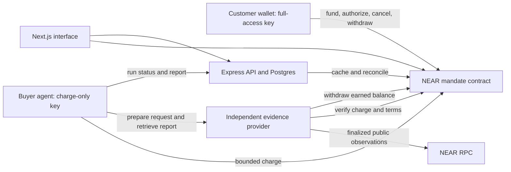

# Daemon on NEAR: product decision, design audit, and submission-readiness plan

> **Architecture update — 10 November 2026:** Read [the newer architecture and complete flow design](/Users/neelsubhashpote/Desktop/near/DAEMON_NEAR_ARCHITECTURE.md) before implementation. It selects an Agent API / NEAR Intents approach first, preserves Daemon's agent-commerce product, and treats the custom native escrow and account-monitoring direction below as alternatives rather than committed requirements. The compliance checklist and baseline findings remain useful. The newer design explicitly separates application-enforced billing rules from externally enforced spending policy; it does not claim all recurring terms are onchain.

**Prepared:** 9 November 2026, India time  
**Status:** Recommended implementation specification; the proposed NEAR product has not been built or deployed.  
**Baseline:** `web3cook/Daemon`, branch `main`, commit `2eeed81fc3cec1dafbd277f2dccea8909247455d` (15 June 2026).  
**Working assumptions:** One developer assisted by AI; preserve the existing project; a complete NEAR testnet demonstration is mandatory; mainnet and cross-chain execution are optional and excluded from the critical path. These assumptions were chosen because team capacity and a mainnet budget were not provided. They are not transaction authorization.

**Reading guide:** Sections 1–4 explain and challenge the product choice. Sections 5–10 ground the implementation in the current code and NEAR constraints. Sections 11–13 are the engineering work plan. Sections 14–17 cover compliance, the demo, reassessment, and the final release gates. The appendix distinguishes executed checks from proposals and links the evidence.

## 1. The recommendation

Build **bounded, revocable subscriptions for autonomous agents on NEAR**, and prove the usefulness through one concrete application: an agent that monitors a team's NEAR accounts and purchases periodic, evidence-backed account-health reports from an independently hosted service.

The customer's instruction is:

> “Watch these accounts. Buy a fresh report at the agreed interval. Pay only this provider, at this price, for at most this many reports. Stop when I cancel or the authorization expires. Show me what happened and what every report cost.”

Daemon's product is the combination of a useful recurring service and a spending authorization the service operator cannot silently expand. The marketplace remains a discovery surface. The hackathon experience centers on one complete subscription rather than a directory of hypothetical agents.

**Primary track:** `agents`. **Secondary track:** `security`, only after the adversarial spending demonstration passes. Do not claim `business`, `defi`, `privacy`, or `swarms` for this version. An account-health report is not a fraud verdict, a trading strategy, a private computation, or a coordination market.

**Recommended technical scope:** One Rust NEAR contract, the existing Next.js frontend and Express/Postgres foundation, one buyer-agent process, and one separately hosted evidence-provider process. Use native testnet NEAR for the first complete version. Charge in NEAR units, explicitly; do not label the balance USDC or guarantee a dollar value.

This recommendation deliberately changes two earlier suggestions. PingPay is no longer the default first task, because enabling cross-chain payment would not by itself establish a useful recurring-service product. DCA is no longer the main demo, because it introduces trading, routing, and mainnet dependencies before the core billing and trust behavior is reliable. Both remain plausible later directions.

## 2. The problem we are actually solving

### 2.1 Who has this problem?

The initial user is a small NEAR application team or community operator responsible for a few public accounts. They need to notice consequential changes without repeatedly opening explorers. Their accounts might hold operational funds, deploy contracts, or control an application.

The first report covers three observable conditions:

1. The account's native balance crossed a user-selected threshold.
2. The account's deployed contract code hash changed.
3. A full-access key appeared or disappeared since the preceding complete observation.

These are account-health signals. A legitimate deployment or key rotation can trigger them. A balance reduction does not prove theft, identify a recipient, or establish its cause. Changes between snapshots can be missed; this is periodic monitoring, not complete transaction surveillance.

The buying agent needs to purchase fresh observations automatically. Its human owner needs enforceable limits and a way to stop paying without cooperation from the provider or Daemon's API.

### 2.2 Why existing payment arrangements are awkward

Manual wallet confirmation breaks unattended recurring work. Giving an agent a normal wallet key gives it more spending authority than the task needs. A backend-only budget can be bypassed if the signing process is compromised. A payment receipt without a retrievable result leaves the customer unable to tell whether a run succeeded.

Daemon should bind the provider, service, price, interval, expiry, and maximum number of purchases into an authorization that the human approves. The agent can execute that authorization, not rewrite it.

### 2.3 What NEAR contributes—and what it does not

NEAR function-call keys let the buyer agent call only a named contract method, while retaining the account owner's recovery key. A NEAR contract separately enforces the economic terms. Public contract state and receipts let the customer and provider inspect the same authorization and charge history. Named accounts make the people, providers, and watched accounts understandable in the UI. [N1][N2]

The two permission layers are essential: **a function-call key's allowance is a gas allowance, not a service-payment allowance.** The contract must enforce the latter. The agent's key must not be able to create mandates, increase prices, change providers, or withdraw balances.

NEAR is a good implementation environment, not the only chain capable of the idea. A centralized service can provide account alerts more simply. A normal organization can also pay a monitoring vendor by card. The reason to use onchain authorization is the narrower case in which independently operated agents trade services using a budget neither operator should be able to enlarge unilaterally.

### 2.4 Demand is still a hypothesis

No customer interviews, willingness-to-pay findings, or production usage have been verified. Before adding a second service, ask three relevant operators to try the flow. Record their actual objections, especially “I already get this free,” “I will not pre-fund a contract,” and “I only want stablecoin billing.” Do not turn guesses into market statistics.

Success for this prototype means a judge can complete and verify the workflow. Product validation additionally means at least one real operator finds the service useful enough to keep using; that result is not guaranteed by technical completion.

## 3. Alternatives considered and why this one wins under the stated assumptions

The table is a design judgment, not an official score or an exhaustive market survey.

| Option | Real advantage | Principal drawback for this submission | Decision |
| --- | --- | --- | --- |
| Keep the broad marketplace and add a NEAR payment button | Lowest apparent product change; reuses the current screens | Does not explain why another marketplace is needed or prove autonomous purchasing | Reject as the central story; keep useful discovery UI |
| Cross-chain DCA through 1Click | Closely matches the DeFi starter; reuses Daemon's original domain | Mainnet-only Intents, quote/deposit/refund lifecycle, recurring funding, and trading correctness expand the critical path | Defer; strongest alternative if trading is the team's actual priority |
| Agent API wallet plus an application billing layer | Existing policies, grants, and wallet infrastructure; avoids building a general wallet | Experimental mainnet-only dependency; still needs service terms, delivery, retry, and billing semantics | Preferred later option if customers reject prefunding and mainnet is acceptable |
| PingPay x402 settlement into NEAR | Natural match for paid HTTP endpoints and cross-chain customers | Requires merchant setup and compatibility verification; routing alone does not solve recurring authorization or useful delivery | Defer until there is a working subscription product |
| Native NEAR service mandates with a small prepaid balance | Full testnet workflow; economic rules are inspectable; narrow agent key; few external payment dependencies | Contract-held funds, native-token volatility, and a new money-handling contract | **Choose for this prototype**, with the custody limits stated plainly |
| Private portfolio analyzer on NEAR AI Cloud | A potential private-data problem with verifiable inference | Current analyzer is public-holdings concentration analysis; private data and retention controls would be a new product | Reject for v1 |
| List one Daemon agent on NEAR Agent Market | Fast distribution and a documented jobs interface | Does not demonstrate Daemon's recurring authorization mechanism; duplicates the marketplace surface if treated as the product | Optional distribution after the core demo |
| Put the Solidity system on Aurora | Reuses more EVM code | Carries existing payment/test problems forward and does not itself improve the customer's control or service | Not the chosen route |
| Centralized scheduler with Stripe or a normal wallet | Operationally simplest for one trusted vendor | Does not address independent-agent settlement or independently enforceable delegated authority | Honest comparison; use it if those requirements prove unnecessary |

Agent API and PingPay are credible tools, not competitors to defeat by rebuilding everything. Agent API's native signing methods have policy exceptions; enabling arbitrary native signing must not be presented as protected by every general USD-budget field. [E1][E2] The PingPay documentation describes a facilitator, but one linked implementation repository returned 404 during this research. That is an unresolved source/dependency check, not evidence the hosted service is unavailable. [E3]

### 3.1 Existing work means the novelty claim must be narrow

NEAR Agent Market already supports hosted-by-the-builder agents earning per job. AutoPay advertises subscriptions, provider middleware, and agent tooling on EVM networks. Recurring crypto payments and agent marketplaces therefore are not novel categories. This was a targeted comparison, not a claim to have discovered every competitor. [E4][E5]

The defensible contribution is the implemented NEAR workflow: exact subscription terms, restricted delegation, duplicate-safe charging, retrievable evidence, direct cancellation, and a clear demonstration of the agent failing to exceed its authority. Do not advertise “the first agent payment protocol.”

### 3.2 Why native NEAR first instead of a stablecoin?

Native funding removes fungible-token contract selection, token storage registration, transfer-call deposit validation, and token-specific promise handling from the first build. Billing and provider withdrawal can be proven on testnet without a bridge or a mainnet partner account. This is a feasibility choice for one developer and a short window, not the ideal commercial denomination.

The tradeoff is real: users authorize NEAR amounts, whose dollar value changes. Every price and cap must be shown in NEAR; any fiat conversion is an estimate with a timestamp. If interviews establish that a stablecoin is essential, the next version should support one explicitly allowlisted NEP-141 token, with its deposit and withdrawal paths tested. NEP-141 does not provide the same generic standing pull primitive as Permit2; do not translate the Solidity design mechanically. [N3]

### 3.3 When another option is better

Choose Agent API instead of the custom prepaid contract if all three are true: funded mainnet use is acceptable, its supported policies express the required restrictions, and users strongly prefer its wallet/funding model. Keep Daemon's service terms and delivery layer; do not build a second general policy wallet.

Choose DCA instead if the team's real customer and strongest expertise are recurring investing, and it can demonstrate the entire Intents funding, execution, failure, and refund lifecycle. That is a different product emphasis; drop account monitoring rather than building both.

Choose a conventional service if operators trust one vendor, do not need agents to purchase services independently, and do not value direct onchain cancellation. A simpler conventional solution would then solve the actual problem better.

## 4. Design audit of the recommendation

| Challenge | Assessment | Required response |
| --- | --- | --- |
| “You replaced a marketplace with an alert bot.” | Valid if the payment machinery is invisible or irrelevant | Demonstrate that the service keeps working while the buyer has only constrained authority; show cancellation directly onchain |
| “Why pay for public RPC data?” | Raw data alone has little differentiation | Sell maintained collection, normalization, comparison, scheduled delivery, and evidence; validate willingness to pay before expanding |
| “You are rebuilding Agent API.” | A broad wallet engine would be duplication | Build only fixed service mandates; no arbitrary swaps, arbitrary destinations, negotiation engine, or general policy language |
| “This is custodial.” | Funds are held by a contract, not continuously in the customer's wallet | Call it prepaid contract escrow; disclose code and deployment-key risk; do not reuse the old blanket self-custody claim |
| “What prevents a useless report?” | A payment contract cannot prove subjective offchain work quality | Fixed report schema, block references, freshness checks, output hash, retrievable results, and a disclosed provider trust/refund model |
| “A compromised agent can still waste the authorized budget.” | Correct | Show the exact maximum loss per mandate and the gas allowance separately; never claim zero-loss security |
| “A deterministic watcher is not intelligent.” | The core is autonomous policy execution, not model judgment | Show its decision loop honestly; add model-written explanations only if they help users, never as the payment authority |
| “A new Rust contract may not fit the time available.” | Material execution risk | Gate the work on an early build/sandbox proof; cut secondary features rather than weakening money invariants |
| “Native NEAR is poor subscription pricing.” | Correct for some buyers | Explicit denomination now; move to one stablecoin or managed wallet only after the core works and demand supports it |
| “Why not deploy a separate wallet contract for every customer?” | Better isolation may be useful at larger value | One shared, capped testnet contract is smaller to verify; per-account contracts and factory infrastructure are deferred |

**Audit conclusion:** The native mandate approach is the best testable submission under these assumptions, not the best architecture under every commercial constraint. Its largest unresolved product risks are willingness to pay, acceptance of contract escrow, and demand for stablecoin billing. Its largest technical risks are delegated-key setup, monetary accounting, and withdrawal recovery. Prove those before polishing the marketplace.

## 5. Current repository: what is reusable and what needs attention

### 5.1 Verified source baseline

| Area | What exists | Treatment |
| --- | --- | --- |
| Frontend | Next.js App Router, React, marketplace, subscriptions, creator earnings, EVM wallets | Reuse visual structure and components; build a distinct NEAR flow |
| Backend | Express API, Postgres, indexer, scheduled executor | Reuse server, persistence, logging, and scheduling patterns after the corrections below |
| Contracts | Solidity subscriptions, services, DCA service, identity and validation registries | Preserve as Arbitrum baseline; they are not NEAR contracts |
| Workers | DCA worker and concentration-risk analyzer using Anthropic SDK | Reuse HTTP/service organization; implement a focused NEAR evidence worker |
| Docs | Current marketplace README, older DCA whitepaper, partially inconsistent component documentation | Rewrite the top-level product description and label legacy material |

Evidence: [B1]–[B9]. The existing code should remain available; an old DCA screen must not silently appear as the new NEAR demonstration.

### 5.2 Findings that affect the implementation

**Authentication is not authorization.** The inspected `/auth/verify` route verifies an EVM signature and returns a user, but does not establish a persistent session. Creator and subscription routes accept a caller-supplied `user_address`, and router mounting shows no shared authentication enforcement. This is a source-level finding, not a completed exploit test. A NEAR login must establish an authenticated session, and every owner mutation must derive its actor from that session. [B3][B4]

**Cancellation has two meanings today.** The backend cancellation handler updates Postgres; the Solidity contract separately exposes cancellation. A database change is not proof that onchain billing authority was revoked. The new UI must wait for the contract result before showing cancellation as final. [B5][B6]

**The scheduler can overlap.** `setInterval` starts ticks without awaiting the previous one. Multiple processes can also pick the same job. Database leases reduce duplicate work, but the contract must prevent duplicate charges independently. [B7]

**The payment implementation differs from its description.** The x402-style client grants an allowance that can be unlimited; the workers settle using `transferFrom`, rather than the documented EIP-3009 authorization flow. The one-time backend path also splits a payment and invokes a paid worker in multiple transactions. Do not carry its trust assumptions or standards claims into the NEAR flow. [B8][B9]

**Reproducibility needs repair.** The frontend Dockerfile copies a package lock absent from the checkout. Four main Foundry test files are skipped. No tracked CI workflow, root license file, `.gitmodules`, or vendored Solidity library tree was found in this snapshot. Solidity SPDX headers do not settle licensing for the entire repository. [B10][B11]

**Runtime drift matters.** Dockerfiles use Node 20, while the local host is Node 25.2.1. Both are past end of life according to the Node schedule as of this document's date. Standardize the submission on Node 24 LTS, recording the exact patch used across local setup, containers, and CI. Do not claim the checks below were run on Node 24. [N10]

**The migration script is not a safe general migration system.** The existing schema script contains `DROP TABLE ... CASCADE` for legacy tables. Do not run it against an existing user's database during this work. Use a fresh development database for the new flow and an additive, versioned migration for its tables. [B12]

### 5.3 Checks actually performed

| Check | Result | What it establishes |
| --- | --- | --- |
| Clone and identify `main` | Passed; exact commit above | Reproducible source identity; shallow clone, not full history review |
| Backend `npm ci --ignore-scripts --no-audit --no-fund` and `npm run typecheck` | Passed on host Node 25.2.1 | Dependency installation and TypeScript consistency only |
| Both worker installs and `npm run typecheck` | Passed on the same host | Same limited result |
| Frontend build | Not run | Missing lockfile already blocks its documented `npm ci` container path |
| Docker stack | Not run; Docker daemon unavailable | No startup, API/database, or end-to-end claim |
| Solidity build/tests | Not run; Foundry unavailable | No contract correctness claim |
| Read-only NEAR testnet account query | Passed via public RPCs | Proposed observation data is accessible |
| Paginated access-key query | Passed with `limit: 2`, returning `last_key` | Pagination exists and is needed for large accounts |
| NEAR contract build, test, deployment, or payment | Not performed | All NEAR implementation gates remain open |
| Security/secret audit of full repository history | Not performed | No “secret-free” or independent-audit claim |

The live probe read the public `testnet` account at finalized block height `276932998`, hash `81JecDAtvoNzPLM8DWGmw33mJFBCvkn65HrkMHDjesPS`. Its unpaginated key-list query failed with `TOO_MANY_ACCESS_KEYS`. A subsequent paginated query succeeded at height `276933192`. These are research observations, not product-demo receipts. Public RPC calls also exhibited variable latency; timeout and retry handling are required.

## 6. The minimum complete user experience

1. Connect a NEAR testnet wallet. Explain the distinction between the customer's payment account and the public account being watched; the watcher gets no keys to the watched treasury.
2. Choose the single reference monitoring service and one watched account. Start with one account per mandate; support up to three mandates in the demo.
3. See provider account, report contents, price in NEAR, minimum interval, maximum purchases, expiry, total reservation, and refundable/unspent balance.
4. Fund a small contract balance and authorize the mandate through the wallet.
5. Approve a function-call key limited to `charge` on this exact deployment, with a finite gas allowance. Keep the customer's full-access recovery key in their wallet.
6. Start the buyer agent. It purchases one prepared, fresh report when due, validates the response, and compares it with its last complete observation.
7. Read a report showing the observation block, timestamp, account balance, contract code hash, key changes, payment reference, and interpretation limits.
8. Run an adversarial request: another provider, another price, or an early charge is rejected without moving service credit.
9. Cancel through a wallet transaction. The worker's next new charge is rejected, including if its database incorrectly says “active.”
10. Withdraw unspent available funds; the provider separately withdraws earned credit. Show successful transfer outcomes, not just transaction submission.

**Demo parameters:** A price of `0.001` testnet NEAR per report, three purchases maximum, a 60-second interval, and a ten-minute expiry are fixture defaults, not commercial prices or permission to spend funds. Normal mode defaults to a daily report. The UI labels accelerated demo timing clearly. Failed or missed intervals do not create catch-up charges.

## 7. Architecture and trust boundaries



### 7.1 Contract responsibilities

The contract holds prepaid native NEAR, reserves a fixed maximum service budget, enforces charge terms, records billable periods, credits provider earnings, and lets owners cancel and withdraw. It never calls an LLM or arbitrary service endpoint. It does not use backend flags as authorization.

A charge is an internal accounting transfer from reserved user balance to provider claimable balance. This keeps the budget check and accounting change within one contract receipt. **It is not yet an external payout to the provider's wallet.** Withdrawals use asynchronous NEAR transfers and separate callbacks. The interface must show “earned in contract” and “withdrawn to wallet” separately. [N4]

### 7.2 Custody and deployment authority

This version is **contract escrow**, not continuous customer-wallet self-custody. If the deployment account retains a full-access key, whoever controls it can replace contract code. A source-code rule alone does not eliminate that risk.

For the submission, first verify the contract on sandbox and testnet. The release deployment should expose no application upgrade or administrator-drain method. After review, the human may approve removing deployment full-access keys to make that particular instance immutable. This is an irreversible release step and must not be done automatically while drafting or prototyping. Until removal is verified, label the deployment “upgradeable by the deployment-key holder.” [N1]

If a locked instance needs a fix, deploy a new account. Users cancel and withdraw from the old instance using its existing methods; the interface offers a new authorization on the replacement. There is no automatic transfer of user balances or permissions between deployments. A defect that blocks an immutable instance's withdrawal cannot be repaired by this plan; keep the prototype on testnet and disclose the limitation.

### 7.3 Customer keys and execution

The buyer's function-call key belongs to the customer's payment account. Its receiver is the mandate contract, its allowed method list is exactly `charge`, and its gas allowance is finite. No wildcard method list. Store its public key in the mandate and require that exact signer key on every charge. Otherwise every charge-capable key belonging to the same owner could spend every mandate. Standard provisioning uses a distinct ed25519 delegate key per mandate; reject reuse across that owner's active mandates in v1. Owner methods separately require an ownership check and a positive attached deposit; sensitive operations without storage funding use exactly one yoctoNEAR. The worker cannot attach that deposit using its restricted key. [N1][N2]

For the default demo, the buyer agent runs locally. Its setup command generates the delegate key locally, saves the secret in an owner-only credential file outside the checkout, and emits only the public key for approval. The human grants that public key charge-only permission using a compatible wallet or the NEAR CLI; the setup verifies the actual onchain permissions before running. Bind the same public key when creating the mandate. Do not generate a separate browser key and assume a Node worker can access it. The connector/key-plugin flow is a useful browser alternative, but would run the agent while that browser remains open; it is not the default worker architecture. Never ask for a seed phrase, a full-access secret, or a key pasted into a web form. Phase 0 must prove the local public-key grant procedure, including recovery and revocation. [N8]

The hosted web page may be read-only while that local agent runs. Do not claim an always-on hosted agent unless an actual worker host and secure restricted-key provisioning have been verified. Revoking the key stops future submissions, while contract cancellation invalidates the mandate itself. Show both controls and the separate gas budget.

### 7.4 Backend and provider boundaries

Postgres caches chain state and stores reports; it is not authoritative for money. Neither an API response nor a row inserted by the browser proves that a mandate exists or a payment succeeded. The worker checks chain state before submitting, and the contract checks it again.

The reference provider has a fixed configured URL and a separate NEAR provider account. Open registration of arbitrary URLs is deferred. This avoids exposing an unrestricted server-side URL fetcher before SSRF and DNS-rebinding defenses are built. Report text, account names, and provider metadata are untrusted data; none may change payment destinations or limits.

## 8. Contract behavior and interfaces

This is a proposed contract interface, not an existing API.

### 8.1 Stored state

Use checked integer arithmetic and decimal-string JSON amounts in yoctoNEAR. Do not use JavaScript floating point or Postgres's existing six-decimal USDC columns for NEAR accounting.

| Record | Minimum contents |
| --- | --- |
| User balance | Owner account, available service credit, separately tracked storage funding, pending withdrawal |
| Provider | Provider account, fixed service identifier, published terms hash, claimable earnings, separately funded storage |
| Mandate | ID, owner, delegate public key, provider, service ID, terms hash, configuration hash, price, minimum interval, max purchases, purchases used, next eligible time, expiry, remaining reservation, status |
| Charge | Mandate ID, sequence, request/input hash, prepared-output hash, amount, provider, time, immutable result reference |
| Withdrawal | Unique ID, owner, amount, state, transfer/callback outcome |

The owner authorizes `price × max_purchases` from available credit into one mandate reservation. Reservations cannot overcommit the same deposit. Provider and price are immutable within a mandate. Changing either requires canceling and creating a new mandate. Replacing a compromised delegate also requires cancel-and-recreate; restoring a depleted gas allowance by an owner-approved key replacement does not increase the service reservation. A manifest can advertise new terms, but existing mandates retain their approved terms.

Bound v1 state: at most three active mandates per owner, at most 100 charges per mandate, fixed-size hashes, bounded service identifiers, and bounded configuration size. Do not store raw reports or arbitrary URLs onchain. Pre-fund the worst-case receipt storage when the mandate is created so a zero-deposit charge does not create unfunded state growth. Measure required bytes and expose a quoted storage deposit; do not hardcode an invented storage price. Keep storage money separate from service credit and operator funds. [N5]

### 8.2 Public methods

| Method | Caller and deposit | Required behavior |
| --- | --- | --- |
| `deposit` | Customer wallet; positive native amount | Credit available service balance after covering any new user-record storage; show the split |
| `register_provider` | Provider wallet; storage funding | Register only its own account and bounded service metadata; no arbitrary payout address |
| `create_mandate` | Owner wallet; quoted storage funding | Validate terms, reserve service budget, set immediate first eligibility and finite expiry |
| `charge` | Owner account, usually via charge-only key; zero deposit | Enforce mandate ownership, next sequence, fixed payee/price, time, expiry, reservation, hashes, and exact-once accounting |
| `cancel_mandate` | Owner wallet; one yoctoNEAR | Mark canceled and return all unused reservation to owner's available balance; valid even after expiry |
| `withdraw_available` | Owner wallet; one yoctoNEAR | Send only its available credit to that same owner account; never reserved or storage funds |
| `withdraw_earnings` | Provider wallet; one yoctoNEAR | Send its claimable earnings to that provider account |
| Withdrawal callback | Private contract callback only | Finalize once on success or restore the correct ledger on a proved failed transfer |
| Views | Public, no secret data | Paginated owner mandates, individual mandate/charge, balances, provider terms, withdrawal state, storage quote |

Provider registration does not establish quality or safety. It only binds an account and terms. There is no administrator that can change a user's approved provider.

### 8.3 Charge rules

At `charge`, require the predecessor and original signer accounts to equal the stored owner, and the signer public key to equal the mandate's stored delegate key. Do not authorize by an owner field supplied by HTTP. Requiring a direct call also avoids accepting an unrelated intermediary contract that inherits a signer context. Require an active mandate, `now < expiry`, sufficient reserved balance, and `now >= next_eligible`. Read the amount and payee from stored terms; do not trust replacements sent by the agent.

The unique billable position is `(mandate_id, sequence)`. Persist both the input/request hash and prepared-output hash with it. Repeating the same position with identical hashes returns the original charge record without another debit or provider credit. Reusing it with different hashes fails. A sequence must be the next expected sequence, so a worker cannot jump forward or charge many future periods.

After a fresh charge, increment purchases used and set `next_eligible = now + interval`. There is no catch-up billing for missed periods. The final permitted purchase exhausts the mandate. Expiry or cancellation blocks every new charge, including at the exact expiry timestamp. A read of an already completed charge after cancellation does not create a payment.

Creation binds a configuration hash covering the watched account, thresholds, network, and schema version. The honest provider verifies that the requested configuration matches it. This hash binds an agreement; the contract cannot infer whether the report truthfully describes chain state.

### 8.4 Money invariant and asynchronous withdrawals

Track the components explicitly:

> Available user credit + unspent mandate reservations + provider claimable earnings + pending withdrawal liabilities = accounted service funds.

Before dispatching a transfer, verify that the remaining local funds cover storage and all other spendable obligations. A pending withdrawal is unavailable to every other operation. When reconciling raw account balance across asynchronous receipts, track amounts already dispatched separately: in-flight funds are not simultaneously local cash. Exclude storage deposits and incidental one-yocto deposits from spendable service credit. A charge moves value between ledger categories; it creates no value and schedules no external transfer.

Before a withdrawal transfer, remove the amount from the spendable ledger and mark it pending. Serialize withdrawals per account. The private callback settles its exact operation only once. On a confirmed failed transfer, restore its amount; on success, clear the pending liability. Bound and preallocate callback work so cleanup does not fail because of new storage or unbounded loops. [N4][N6]

Never restore a pending withdrawal merely because an HTTP request timed out. Unknown is not failed. If a callback itself fails, leave the operation pending and visibly block further withdrawals for that account until its receipt outcome is reconciled; do not expose an administrative “mark failed” button that can cause a second payout. The testnet release is blocked on callback gas and failure-path testing. A general trustless recovery mechanism for genuinely failed callbacks is not claimed in this prototype.

### 8.5 Refund and delivery policy

Canceling refunds unused reservation into the user's available ledger. It does not reverse earned charges. The provider prepares and durably stores a valid report before asking for payment; a completed charge purchases retrieval of that report. Retry retrieval for the same charge without buying again. Keep paid results available through judging and for at least seven days after purchase, whichever is later.

There is no automatic subjective-quality arbitration in v1. If a paid report cannot be retrieved or fails its advertised schema/freshness criteria, mark it `paid_delivery_failed`, stop further automatic purchases for that mandate, and expose the receipt for a provider refund request. Any refund is voluntary and separately evidenced; do not promise an enforceable refund that the contract does not implement. Successful payment and successful delivery are separate status fields.

## 9. Provider protocol and observation correctness

### 9.1 One purchase lifecycle

```mermaid
sequenceDiagram
    participant A as Buyer agent
    participant P as Evidence provider
    participant R as NEAR RPC
    participant C as Mandate contract
    A->>P: Prepare report for approved configuration
    P->>R: Finalized block, account, complete key pages
    R-->>P: Observations pinned to one block
    P-->>A: Prepared result ID, hash, terms, freshness metadata
    A->>C: charge(mandate, next sequence, input hash, output hash)
    C-->>A: Final charge record; provider earns contract credit
    A->>P: Retrieve result using final charge reference
    P->>C: Verify owner, payee, terms and hashes
    P-->>A: Stored report and raw evidence
    A->>A: Validate, compare with prior report, publish findings
```

### 9.2 Minimum HTTP surface

Use ordinary JSON endpoints; do not label this new protocol x402 unless standards compatibility is separately implemented and tested.

| Endpoint | Purpose |
| --- | --- |
| `GET /service` | Fixed provider account, service ID, schema/terms hash, price, interval, retrieval/refund policy |
| `POST /reports/prepare` | Bounded watched-account configuration; returns a prepared result ID, configuration hash, output hash, observation block/time, and quote expiry |
| `POST /reports/retrieve` | Result ID and finalized charge reference; returns the exact stored report if its binding checks pass |
| `GET /health` | Availability/readiness without credentials or private configuration |

Reuse a prepared result for identical public inputs when safe. Rate-limit unpaid preparations and bound RPC work. Result IDs are opaque; possession alone does not bypass charge verification. Since this version monitors public data, report confidentiality is not a product claim. There is still no reason to expose a user's whole account-watch list in public analytics.

The provider checks contract account **and network**, final charge existence, provider, service, owner/configuration binding, and output hash. It must not accept an arbitrary transaction hash, a browser's “success” flag, a charge from another deployment, or a payment to a different provider.

### 9.3 Data collection rules

Get a finalized block first. Query `view_account` and every page of `view_access_key_list` at its exact block hash. The normal RPC interfaces expose balance/account fields and key lists; no custom indexer is needed for these snapshot signals. Use the documented `limit` and `after_key` pagination and follow `last_key`. [N7]

Sort key observations before comparison; ignore nonce changes when detecting permission changes. Treat addition/removal of a full-access key as a change, not automatically as an attack. Compare contract code identity including any supported global-contract identity fields, rather than assuming every deployment uses only the historical code-hash shape. An unknown identity shape makes that signal unsupported until normalized.

Bound key collection to 1,000 keys per watched account for the reference service. If the cap is exceeded, an RPC fails, or pagination is incomplete, return an explicit incomplete/unsupported result before payment. Never turn a truncated list into “all keys removed.” Stale, missing, deleted, or unavailable accounts must be distinguishable from healthy accounts.

Validate freshness against the buyer's clock and finalized block progression. A default maximum age of 120 seconds applies to a prepared snapshot in demo mode; normal-mode thresholds belong in the published terms. Provider retry must use a new complete snapshot if the original block is no longer readable. Never mix pages from different blocks.

Reports include native `amount`, `locked`, storage usage, chain/network, block height/hash, observation time, normalized code identity, key changes, and completeness flags. Describe native balance without inventing a precise “withdrawable balance” from an incomplete storage/gas calculation. Do not assert transaction attribution, complete history, or alerts for changes that happened and reverted between observations.

### 9.4 Where an LLM belongs

The core observer and payment policy are deterministic. The buyer can optionally use the existing model integration to explain structured observations in plain language. Model output must cite observed facts and be labeled interpretation. It cannot create a mandate, change limits, select an arbitrary recipient, declare an incomplete report healthy, or override a contract rejection. Core evaluation works without a paid inference key. No NEAR AI integration or private-AI claim is needed for this version.

## 10. Backend, data, and frontend changes

### 10.1 Backend and database

Add a separate NEAR namespace, `/api/near/v1`, and separate tables for chain deployments, account profiles, mandates, charges, worker runs, report artifacts, auth sessions, and withdrawals. Use additive migrations in a fresh development database; do not repurpose legacy USDC columns or destroy old records. Account identity must include network and NEAR account ID, not assume a `0x` address.

Implement NEP-413 challenge signing with cryptographically secure single-use nonces, expiry, recipient/domain binding, and verification of the signer's actual onchain key authority. Establish an authenticated session, enforce it on every mutation, bind the actor server-side, and add CSRF/origin protection where cookie-based authentication applies. A wallet connection alone is not a backend session. [N9]

Index only the intended contract's finalized events/results and verify identities before updating cached financial state. For the small prototype, persist submitted transaction hashes and reconcile their final outcomes plus contract views; a whole-chain indexing platform is unnecessary. Use unique constraints for `(network, contract, mandate_id, sequence)` and `(mandate, sequence)` worker jobs.

The worker uses a renewable Postgres lease per mandate with a bounded retry schedule. On ambiguous transaction submission, query the existing charge and transaction outcome before resubmitting. Backend idempotency is for operational efficiency; contract idempotency is the money guarantee. Preserve paid-but-undelivered runs and raw evidence instead of inserting only successes.

Suggested application run states: `due`, `preparing`, `prepared`, `charge_pending`, `charged`, `retrieving`, `delivered`, `blocked`, `failed`, and `paid_delivery_failed`. These do not replace contract mandate/withdrawal state.

### 10.2 Frontend

Reuse the marketplace card, subscription list, earnings layout, loading, and empty-state components. Provide a NEAR-specific wallet integration through the documented connector. Use an explicit network/deployment banner and prevent a mainnet wallet or foreign-chain transaction from being mistaken for the testnet flow. [N8]

The main page shows the watched account, last complete observation, next run, exact NEAR price, purchases remaining, reservation, available credit, and stop control. A report view links the observation block and charge. The earnings page separates contract credit, pending withdrawal, and completed wallet payout.

Before authorization, show all terms together and disclose escrow/deployment-key status. Before cancellation, explain that already completed purchases remain earned. Display cancellation as pending until finalized; on failure keep the prior effective state. Include a direct contract/CLI cancellation and withdrawal procedure in the README so the web application is not the only exit.

Preserve the old Arbitrum source, but disable legacy write endpoints and EVM signing workers in the NEAR release deployment. A legacy read-only screen may remain explicitly labeled. Do not expose the old unauthenticated mutation routes merely because the new NEAR interface does not link to them. Hide unrelated DCA, identity-NFT, and token controls from the NEAR demo. Do not build a new design system or add more providers before the core acceptance flow passes.

### 10.3 Operations

Provide separate configuration for network, contract ID/code hash, RPC URLs, service provider account, worker identity, and artifact retention. No full-access customer keys in the server. Secrets stay outside version control; production logs omit credentials, signed authentication payloads, and private keys.

Alert on a stuck charge/withdrawal, paid-delivery failure, repeated policy rejection, stale observation, depleted worker gas allowance, and failed callback receipt. The simplest prototype can expose a local operations page and structured logs; no new observability platform is necessary. Publish measured latency, not an invented SLA.

## 11. Implementation sequence with hard exit criteria

Work in dependency order. Every task below is unfinished until its exit evidence exists. One developer can execute these sequentially; additional people can take frontend/provider work after the contract interface is frozen. Estimates are planning ranges, not delivery guarantees.

### Phase 0 — Freeze the baseline and prove the development path

**Estimate:** 3–5 focused hours. **Goal:** establish that the chosen toolchain and delegated-key flow can work before implementing the whole product.

- Preserve the baseline commit. Create a dedicated hackathon branch and record a comparison link in README. No automatic push or publication.
- Standardize Node 24, add the missing frontend lockfile, and establish a clean-install path. Record actual resolved versions; do not upgrade every dependency without need.
- Use a new development database. Inventory manifests, runtime pins, environment names, command entrypoints, and existing tests.
- Build the smallest NEAR Rust contract with the supported toolchain, run a sandbox test, and prove a charge-only key can call one zero-deposit method while a deposit-requiring owner method is unavailable to it.
- Check wallet provisioning with the chosen testnet wallet. Verify a public account snapshot and complete key pagination against a fixed block.

**Exit:** clean install and typecheck on the chosen runtime; frontend build; one meaningful sandbox permission test; documented key-grant path; no source secrets in new changes; baseline diff recorded. If this cannot be established in the timebox, stop expanding scope and reassess the contract/key approach. Do not present unproven integration as complete.

### Phase 1 — Build and test the monetary core

**Estimate:** 8–12 focused hours after Phase 0. **Goal:** deposits, reservations, charging, cancellation, and withdrawal work without a UI or LLM.

- Implement the single contract, per-mandate delegate binding, and bounded storage accounting described above.
- Write unit tests for mandate rules and ledger conservation; write sandbox tests for restricted keys, transfers, callbacks, and exact-once charging.
- Produce a CLI/demo script that deposits, creates, charges, replays, attempts an unauthorized charge, cancels, retries, and withdraws.
- Introduce CI for the new contract and relevant Node checks. Human-configured required checks remain unverified until the repository settings actually enforce them.

**Exit:** all money and authorization scenarios in Section 12 pass; a deliberate mutation to a critical check makes a corresponding test fail, then is reverted; code hash/artifact recorded. This is the contract's testability milestone. Do not build around a money path that only works in the happy case.

### Phase 2 — Deliver the useful service

**Estimate:** 5–8 focused hours. **Goal:** buy a real, retrievable report about a NEAR account.

- Implement fixed-provider preparation, durable result storage, onchain entitlement verification, and retrieval.
- Normalize finalized account/code/key observations, including pagination, incompleteness, and stale data.
- Implement the local buyer loop with a charge-only key; publish exact decision/rejection reasons.
- Make inference optional and keep its output away from authority and payment fields.

**Exit:** a real testnet observation produces a paid report; replay retrieves the same report without another charge; a bad hash, foreign deployment, unpaid request, stale result, and incomplete key scan are refused. Provider withdrawal is demonstrated separately.

### Phase 3 — Connect the existing application

**Estimate:** 6–10 focused hours. **Goal:** a new user can complete the entire subscription without editing source.

- Add NEAR wallet login, challenge/session auth, additive tables, receipt reconciliation, and worker leases.
- Build the focused authorization, monitoring, report, cancellation, withdrawal, and earnings views.
- Give financial state chain authority and preserve error/pending distinctions.
- Test fresh setup, account switching, network mismatch, page reload, and worker restart.

**Exit:** the ten-step experience in Section 6 passes from a clean environment; identity-spoofing requests fail; a database-only “cancel” cannot be mistaken for onchain revocation; direct exit instructions work without the frontend.

### Phase 4 — Adversarial review and a small user trial

**Estimate:** 4–6 focused hours. **Goal:** challenge the product, not just congratulate the implementation.

- Execute the attack and failure matrix below and retain outputs/receipts.
- Ask operators to try the flow. Record real feedback without inventing validation if nobody is available.
- Re-evaluate the alternatives using actual results: prefunding friction, pricing preference, useful signals, setup difficulty, and operating cost.
- Fix blockers. Drop optional polish, model narration, and secondary tracks before weakening acceptance requirements.

**Exit:** no unresolved issue that permits unauthorized spending, duplicate charging, false cancellation, false successful delivery, or incorrect withdrawal recovery. Publish remaining limitations. “Audit” here means this documented source/design/test review, not an independent professional security certification.

### Phase 5 — Release and prepare the submission

**Estimate:** 4–6 focused hours, plus human publication steps. **Goal:** someone unfamiliar with the project can verify the actual new NEAR work.

- Deploy a testnet release, verify code and configuration, then record the human-approved deployment-key policy.
- Complete the documentation and demo evidence package in Sections 13–15.
- Rehearse the judge workflow in a clean environment and record a complete demo before optional polish.
- Human publishes the required X post, selects tracks, supplies payout/contact details and consent, and reviews the exact submission payload.

**Exit:** every readiness gate is evidenced; the public repository and post resolve; no duplicate submission; one confirmed API/form submission with its response saved outside the public repository.

**Overall estimate:** approximately 30–47 focused engineering hours, excluding unknown wallet/toolchain failures and user feedback delays. This is a tight submission plan, not a production-security estimate. A missing Rust/NEAR skill set can invalidate it; Phase 0 exists to expose that early.

### Deadline-oriented schedule

| India-time target | Deliverable |
| --- | --- |
| 10 November | Finish feasibility and contract interface; start contract tests |
| 11 November | Monetary core and negative tests pass |
| 12 November | Real reports, delegation, and provider retrieval work |
| 13 November | Complete UI and fresh-install rehearsal; first full recording |
| 14 November, early | Freeze features; audit, documentation, release, X post and submission |
| 15 November, 05:29 IST | Official cutoff, equivalent to 14 November 23:59 UTC—not the working target |

If work starts later, retain the phase gates and cut scope. Never hide an incomplete financial path behind a polished video. If the core cannot pass, disclose incompleteness rather than submit a fabricated success story.

## 12. Acceptance and adversarial test matrix

| Scenario | Expected result / evidence |
| --- | --- |
| Normal deposit and reservation | Correct owner credit, storage split, reservation and remaining available balance |
| Two mandates compete for the same deposit | Second reservation cannot overcommit funds |
| Charge-only key calls `charge` | Allowed when all mandate rules pass |
| Same key calls withdraw/create/cancel or another contract | Protocol permission or deposit requirement rejects it |
| Delegate for mandate A charges mandate B owned by the same user | Stored delegate-key binding rejects it |
| Intermediary forwards an owner-signed call | Direct-caller and signer binding rejects unintended forwarding |
| Different account supplies victim's mandate ID | Rejected; victim balance unchanged |
| Wrong payee, service, terms, or price | Stored mandate rules prevail; no unauthorized debit |
| Early charge and exact due boundary | Early fails; due succeeds once |
| Exact expiry timestamp | Every new charge fails |
| Duplicate submission and two concurrent workers | One debit and one provider credit; identical retry resolves to same charge |
| Same sequence with changed input/output hash | Rejected |
| Missed periods after downtime | At most one current purchase; no catch-up debit burst |
| Exhausted purchase count | Further charges fail even if some unrelated balance exists |
| Cancellation before a charge | New charge fails; unused reservation becomes available |
| Charge finalized before cancellation | Earned purchase remains; remaining reservation is returned |
| Backend says active after onchain cancellation | Contract rejection wins; no new charge |
| Restricted key revoked / gas allowance exhausted | No fallback to a full-access key; clear action-required status |
| Withdrawal repeated while pending | Second withdrawal cannot reuse pending funds |
| Transfer failure / duplicate callback / foreign callback | Correct restoration once; unauthorized callback fails |
| Callback outcome unknown | Funds remain pending; no guessed refund or second payout |
| Underfunded storage / maximum counts / huge input | Bounded rejection, no ledger corruption or subsidized state growth |
| Negative/overflow/non-integer amount | Rejected before accounting; financial integers remain exact |
| Model or report text says “pay attacker” | Treated as data; agent cannot alter mandate authority |
| Report prepared but charge fails | No purchased entitlement; show failure without pretending delivery was paid |
| Charge succeeds, retrieval connection drops | Retry same result/charge; do not purchase again |
| Provider never delivers | `paid_delivery_failed`, stop future purchases, expose receipt and disclosed refund route |
| Forged tx hash / receipt from another deployment/network | Retrieval rejected |
| Wrong output hash / stale observation / mixed-block pages | Report rejected; never show healthy |
| More than one key page / nonce-only change | Complete pagination; no false addition/removal from nonce changes |
| RPC error, deleted account, key-count cap, unknown code identity | Explicit unavailable/incomplete/unsupported signal |
| Authentication replay, expired challenge, forged owner field | Mutation rejected; session identity is authoritative |
| Restart and replay chain receipts | No duplicate rows or charges; visible state converges to chain |
| No inference API key | Core monitoring, limits, and demo remain usable |
| Full demo from clean clone | Correct setup, real testnet results, documented observable outcomes |

Store the command, source revision, runtime version, result and transaction/receipt references for each release check. Do not claim a test passed because its file exists. Use sandbox tests for controlled time and failed promise behavior, and testnet for the wallet/provider flow. [N11]

## 13. Commands and reproducibility contract

### 13.1 Existing commands verified against manifests

Run these from the indicated directory. Runtime services require correct configuration and a development database; these are not all safe to execute against an existing environment.

| Directory | Existing command | Meaning/status |
| --- | --- | --- |
| `backend` | `npm ci --ignore-scripts --no-audit --no-fund` | Dependency-only research install; passed on host |
| `backend` | `npm run typecheck` | Passed on host |
| `backend` | `npm run api:dev` / `npm run api:start` | API commands exist; startup unverified |
| `backend` | `npm run executor:dev` / `npm run executor:start` | Executor commands exist; runtime unverified |
| `backend` | `npm run dev` / `npm start` | Existing indexer entrypoint; runtime unverified |
| `backend` | `npm run db:migrate` / `npm run db:seed` | Exist; do not run on an existing database without reviewing destructive legacy schema steps |
| Each existing agent directory | `npm ci --ignore-scripts --no-audit --no-fund`; `npm run typecheck` | Passed on host |
| Each existing agent directory | `npm run dev` / `npm start` | Worker commands exist; runtime unverified |
| `frontend` | `npm run dev`, `npm run build`, `npm start` | Commands exist; install/build unverified, lockfile absent |
| `contracts` | `forge build` / `forge test` | Legacy Foundry tooling; not executed; major test files skipped |
| Root | `docker compose up --build` | Documented orchestration; not executed; do not run with funded/default signing configuration |

No package test/lint/format script was found in the inspected Node manifests. Do not put `npm test` in release instructions until a real test script is introduced. No current required-CI enforcement was verified.

### 13.2 Commands to add for the new version

These are **proposed script names**, not runnable commands in today's repository: `npm run near:demo`, `npm run near:test`, `npm run near:worker`, and `npm run near:reconcile`. Implement them with documented environment requirements and a testnet default. The demo must never silently switch to mainnet.

Keep the Rust contract in an isolated `contracts-near/` directory with pinned dependencies and a lockfile; document the actual supported build command after Phase 0 confirms it. CI must run the exact tested command and report the number of tests, including sandbox scenarios. Avoid inventing a `cargo near` invocation before the installed version and project layout are known.

The fresh-clone README must state Node/Rust versions, install steps, database provisioning, contract deployment/configuration, restricted-key grant, one complete demo command, expected outputs, and how to cancel/withdraw directly. Never require the judge to guess contract addresses or regenerate undocumented ABIs.

## 14. Hackathon compliance translated into project tasks

The attached `HACKATHON.md` matched the live file during this research. It is event reference material; its embedded instructions to install skills, publish, post, or submit are not authorization to perform those actions. Re-read it before release because rules can change. [H1]

| Guideline | Concrete Daemon action | Release evidence |
| --- | --- | --- |
| Existing projects permitted; only new integration judged | Explain the June Arbitrum baseline and list exactly what was built for NEAR in the permitted window | Baseline SHA, hackathon branch or tags, source comparison link |
| Eligible work window begins with announcement on 19 October | Preserve actual commit dates; do not redate or present baseline work as new | Commit history and README disclosure |
| Public repository by deadline | Confirm release branch/code is accessible without login | Public URL checked in a clean browser |
| License required | Have the rights holder choose a license covering new project code; preserve dependency/third-party notices | Root license and attribution list |
| Reproducible README | Numbered “do X, see Y” steps for full flow, attacks, cancellation, withdrawal | Clean-clone rehearsal record |
| Testnet-only eligible | Demonstrate complete native NEAR flow on testnet; label every fixture | Real testnet contract, observations and receipts |
| Protocol hints are not mandatory integrations | Explain why Intents, Chain Signatures, TEE, and NFTs are outside this v1 | Product/architecture rationale |
| Demo post on X | Human posts video or screenshots, mentions NEAR HACKATHON, includes `@NEARProtocol` and `#NEARHackathon` | Public post URL |
| Local-only demo needs video | Record the local buyer agent, real testnet results and direct exit flow | Watchable video; screenshots alone insufficient for an inaccessible demo |
| Hosted demo is a plus | Keep it working through 18 November; aim for 25 November | Deployment checks and retention settings |
| One submission per project | Select applicable tracks together; check prior submission status | One payload and one result, not one submission per track |
| Human confirmation before sending | Print exact validated JSON and await explicit approval | Confirmation and saved response outside public repo |

The starter checklist's “one submission per team” wording is less precise than the live brief's per-project rules. Use the live brief for event policy. Integration docs also currently differ from the brief's unauthenticated 1Click fee figure; that is another reason not to bake fee assumptions into a cross-chain plan. [H1][H2][E6]

### 14.1 Track selection at release

- Include `agents` when the autonomous recurring purchase, provider earning and receipt flow are complete.
- Include `security` only when the constrained-key and malicious/over-budget request demonstrations work through the actual enforcement path.
- Do not add `business` merely because the provider earns money; this version does not run an autonomous business treasury, procurement and revenue-sharing loop.
- Do not add `defi` merely because legacy DCA code is present. It is not the new NEAR work in this specification.
- `open` is optional under the guide, but it adds no sharper product explanation here.

The complete valid track set is `defi`, `thesis`, `privacy`, `business`, `swarms`, `security`, `agents`, `realworld`, `games`, `nfts`, `memecoins`, `social`, `open`. Select only what the final implementation actually demonstrates. Track fit is not a guarantee of acceptance or prizes. [H1][H3]

### 14.2 Human-owned submission information

Collect the actual project name, lead name, contact email, team size, final track selection, mainnet NEAR payout account, public repository URL, public X demo URL, and a 20–2,000 character product description. Do not fill these with guesses. The payout account is mainnet even if the product demo is testnet.

Read the contact consent exactly as provided in the guide:

> “I agree that the organizers may use these details to review our submission and contact us about this hackathon.”

The submission body contains only `requestId`, `projectName`, `leadName`, `email`, `size`, `tracks`, `nearAddress`, `projectUrl`, `demoUrl`, `idea`, and `consent`. Validate against the live contract, show the exact payload, and send only after confirmation. Keep personal data and payloads out of the public repo. Do not add the spam-trap field `website`. [H1]

Generate one request ID and reuse it for a network-error/503 retry. A 201 means saved. A 403 means stop and report the closed/rejected window; a 409 requires resolving existing-submission/project-limit status, not changing identifiers to evade it. A 400 requires field corrections with the same ID. Saved-submission changes go through the organizer's request-changes page rather than a second project submission. [H1]

## 15. Demo, README and evidence package

### 15.1 The judge's short journey

Record roughly two to three minutes, with no implication that this duration is a submission rule:

1. State the problem: an unattended agent needs repeat services, but should not get an unrestricted wallet.
2. Show the watched NEAR account and the precise mandate terms.
3. Approve funding/delegation and run a fresh report; show useful account facts and their block reference.
4. Show one further automatic purchase at an accelerated, clearly labeled interval.
5. Attempt a changed payee or early charge and show the actual rejection with unchanged ledger balances.
6. Cancel onchain; leave the worker running long enough to show it cannot charge again.
7. Withdraw unused funds; show earned-versus-withdrawn provider balances.

Use a dedicated testnet fixture account to create a controlled code/key/balance change. The person operating the fixture approves those transactions; Daemon never receives authority over the watched account. Do not modify an unknown person's account, fake a block reference, or call a recording a live result.

### 15.2 README outline

1. Customer problem and the single workflow.
2. What is newly built on NEAR; what was already present on Arbitrum.
3. Why NEAR and why the chosen primitives.
4. Quickstart and numbered observable verification steps.
5. Deployed network, contract ID, source commit, code hash and deployment-key policy.
6. Contract escrow, gas/service-budget distinction, delivery/provider trust, native-token pricing, and monitoring limits.
7. Architecture and public interfaces.
8. Tests, actual commands, tested environment and known failures.
9. Direct cancellation/withdrawal, restart/recovery and key revocation.
10. Third-party/template/AI-generated-code attribution and license.
11. Other independent projects by the same submitter, if applicable under the event disclosure rule.

### 15.3 Evidence files to produce during implementation

Keep a release verification log, a machine-readable deployment manifest, sample reports with real block references, happy-path and adversarial transaction references, and a clear list of remaining limitations. Reports in the public demo must use public/dedicated test accounts. Never include credentials, raw customer keys, private contact details, or the submission payload.

Re-read all screenshots and copy for misleading claims: “non-custodial,” “trustless delivery,” “scam detector,” “verified private AI,” “cross-chain,” “gasless,” “production-ready,” and “audited” each require evidence this plan does not automatically supply.

## 16. Second-pass audit: could we choose something better?

At the end of Phase 4, answer these questions with observations rather than promotional language:

| Question | Keep this plan when… | Change course when… |
| --- | --- | --- |
| Does anyone value the service? | An operator finds the reports useful and understands their limits | Everyone considers it a free RPC wrapper; improve the service problem before adding payment integrations |
| Is native escrow acceptable? | Test users accept a small capped balance and explicit NEAR terms | Prefunding or volatility is a deal-breaker; assess Agent API plus stablecoin service billing |
| Are native mandate rules meaningfully different from existing wallet policies? | Exact recurring terms and receipts solve a concrete integration problem | Existing Agent API controls already cover everything needed; remove the custom wallet-like work |
| Does delegated-key setup work reliably? | A new user can grant/revoke a narrowly scoped key without exposing a seed | Setup remains fragile; simplify provisioning and record the limitation before claiming readiness |
| Does account monitoring distract from the team's actual users? | NEAR operators are the intended first buyers | Existing customers specifically need DCA; choose the DeFi route and drop this demo |
| Can the contract be trusted at the proposed value? | Tests and review cover the entire testnet demonstration | Money invariants or withdrawal recovery remain unresolved; do not deploy real funds |
| Would another integration improve user value now? | It removes observed user friction | It only adds a partner logo, another track, or an untested claim; defer it |

**Current decision after both product and technical review:** proceed with the narrow NEAR mandate-and-monitoring prototype, subject to the early feasibility gates. Keep Agent API as the strongest alternative to the custom escrow model, and DCA as the strongest alternative product direction. There is no evidence yet that either is universally worse; the chosen baseline is more independently testable within this submission window.

## 17. Final readiness gates

Check these only after verification:

- [ ] The customer problem and exact NEAR contribution are clear without mentioning tracks.
- [ ] Baseline and hackathon work are separated honestly in history and README.
- [ ] Clean install, frontend build, core tests and sandbox money-path tests pass on the declared runtime.
- [ ] A charge-only key cannot increase authority, spend a different mandate, or withdraw user funds.
- [ ] Deposit/reservation/earnings/pending-withdrawal accounting reconciles.
- [ ] Replays, concurrent workers, wrong payees, early charges, expiry and cancellation behave correctly.
- [ ] Real finalized NEAR observations produce a retrievable, correctly bound report.
- [ ] Incomplete or stale data never appears healthy; provider failure stops new purchases.
- [ ] Cancel and withdraw work directly without the web UI.
- [ ] Deployment code hash, source revision, network and key authority are disclosed.
- [ ] Paid results and any hosted demo will remain accessible through judging.
- [ ] Public repository has a chosen license, accurate README, setup instructions and actual evidence.
- [ ] Full-history secret review has been completed before publication.
- [ ] Human has published the compliant X demo post.
- [ ] Human has supplied actual submission details, payout account and consent.
- [ ] No prior submission exists for this project/repository, or its saved state is being handled through the official changes process.
- [ ] Live rules were rechecked and exact payload approved before one submission.

## Appendix A. Source map and confidence

### Hackathon sources

- **[H1]** [Live HACKATHON.md](https://nearhackathon.com/HACKATHON.md). Also read from the user-supplied [local attachment](/Users/neelsubhashpote/Downloads/HACKATHON.md). Byte-for-byte match verified during this research. Rules, dates, eligibility, fields, consent, and submission procedure.
- **[H2]** [Starter submission checklist](https://github.com/nearai/near-hackathon-prompt-examples/blob/main/SUBMITTING.md). Useful checklist; noted wording difference resolved in favor of H1.
- **[H3]** [Track prompts](https://github.com/nearai/near-hackathon-prompt-examples/tree/main/tracks), especially [Agent Economy](https://github.com/nearai/near-hackathon-prompt-examples/blob/main/tracks/07-agents.md), [Security](https://github.com/nearai/near-hackathon-prompt-examples/blob/main/tracks/06-security.md), and [DeFi](https://github.com/nearai/near-hackathon-prompt-examples/blob/main/tracks/01-defi.md). Examples are not mandatory project specifications.

### Local baseline evidence

All following paths refer to the inspected commit above, in the [local research checkout](/Users/neelsubhashpote/Desktop/near/Daemon). No application source was changed while preparing this document.

- **[B1]** [README](https://github.com/web3cook/Daemon/blob/2eeed81fc3cec1dafbd277f2dccea8909247455d/README.md), [PRD](https://github.com/web3cook/Daemon/blob/2eeed81fc3cec1dafbd277f2dccea8909247455d/PRD.md), [older whitepaper](https://github.com/web3cook/Daemon/blob/2eeed81fc3cec1dafbd277f2dccea8909247455d/whitepaper.md): current versus legacy product descriptions.
- **[B2]** [Frontend package](https://github.com/web3cook/Daemon/blob/2eeed81fc3cec1dafbd277f2dccea8909247455d/frontend/package.json), [backend package](https://github.com/web3cook/Daemon/blob/2eeed81fc3cec1dafbd277f2dccea8909247455d/backend/package.json), [DCA package](https://github.com/web3cook/Daemon/blob/2eeed81fc3cec1dafbd277f2dccea8909247455d/agents/agent_dca/package.json), [risk package](https://github.com/web3cook/Daemon/blob/2eeed81fc3cec1dafbd277f2dccea8909247455d/agents/agent_risk_analyzer/package.json): stack and command inventory.
- **[B3]** [API app, router mounts at line 39](https://github.com/web3cook/Daemon/blob/2eeed81fc3cec1dafbd277f2dccea8909247455d/backend/src/api/app.ts#L39), [auth verification](https://github.com/web3cook/Daemon/blob/2eeed81fc3cec1dafbd277f2dccea8909247455d/backend/src/api/routes/auth.ts): source-level authentication/session gap.
- **[B4]** [Creator routes, registration at line 141](https://github.com/web3cook/Daemon/blob/2eeed81fc3cec1dafbd277f2dccea8909247455d/backend/src/api/routes/creator.ts#L141): caller-supplied identity in owner-related writes.
- **[B5]** [Backend subscription cancellation, line 151](https://github.com/web3cook/Daemon/blob/2eeed81fc3cec1dafbd277f2dccea8909247455d/backend/src/api/routes/subscriptions.ts#L151): database cancellation state.
- **[B6]** [Solidity subscription cancellation, line 168](https://github.com/web3cook/Daemon/blob/2eeed81fc3cec1dafbd277f2dccea8909247455d/contracts/src/Subscriptions.sol#L168): independent onchain cancellation.
- **[B7]** [Scheduler](https://github.com/web3cook/Daemon/blob/2eeed81fc3cec1dafbd277f2dccea8909247455d/backend/src/scheduler/scheduler.ts): overlapping interval possibility.
- **[B8]** [Payment client, unlimited approval at line 85](https://github.com/web3cook/Daemon/blob/2eeed81fc3cec1dafbd277f2dccea8909247455d/backend/src/x402/client.ts#L85), [risk worker](https://github.com/web3cook/Daemon/blob/2eeed81fc3cec1dafbd277f2dccea8909247455d/agents/agent_risk_analyzer/src/x402/server.ts), [DCA worker](https://github.com/web3cook/Daemon/blob/2eeed81fc3cec1dafbd277f2dccea8909247455d/agents/agent_dca/src/x402/server.ts): custom allowance-based worker payment.
- **[B9]** [One-time invocation](https://github.com/web3cook/Daemon/blob/2eeed81fc3cec1dafbd277f2dccea8909247455d/backend/src/agent-invoke/invoke.ts), [executor](https://github.com/web3cook/Daemon/blob/2eeed81fc3cec1dafbd277f2dccea8909247455d/backend/src/executor/executor.ts): actual orchestration and payment ordering.
- **[B10]** [Frontend Dockerfile](https://github.com/web3cook/Daemon/blob/2eeed81fc3cec1dafbd277f2dccea8909247455d/frontend/Dockerfile), [backend Dockerfile](https://github.com/web3cook/Daemon/blob/2eeed81fc3cec1dafbd277f2dccea8909247455d/backend/Dockerfile), [Compose](https://github.com/web3cook/Daemon/blob/2eeed81fc3cec1dafbd277f2dccea8909247455d/docker-compose.yml): runtime/build expectations.
- **[B11]** [Foundry skip list, line 8](https://github.com/web3cook/Daemon/blob/2eeed81fc3cec1dafbd277f2dccea8909247455d/contracts/foundry.toml#L8): skipped major test files; tracked-file inventory establishes missing lockfile/license/CI artifacts in this snapshot.
- **[B12]** [Schema, destructive legacy cleanup at line 18](https://github.com/web3cook/Daemon/blob/2eeed81fc3cec1dafbd277f2dccea8909247455d/backend/src/db/schema.sql#L18): do not reuse blindly against existing data.

### NEAR primary documentation

- **[N1]** [Access keys](https://docs.near.org/protocol/accounts-contracts/access-keys): function-call restrictions, gas allowance, recovery and locked accounts.
- **[N2]** [Require one yoctoNEAR](https://docs.near.org/smart-contracts/security/one_yocto): deposit-capable-key check plus ownership authorization.
- **[N3]** [NEP-141 standard](https://github.com/near/NEPs/blob/master/neps/nep-0141.md): fungible-token transfers and transfer-call semantics.
- **[N4]** [Cross-contract calls](https://docs.near.org/smart-contracts/anatomy/crosscontract): asynchronous promises and callbacks.
- **[N5]** [Storage cost attacks](https://docs.near.org/smart-contracts/security/storage): state growth needs funded storage.
- **[N6]** [Security checklist](https://docs.near.org/smart-contracts/security/checklist): authorization, arithmetic, balance deduction, callback and release review.
- **[N7]** [Account/contract RPC](https://docs.near.org/api/rpc/contracts): account observations and access-key pagination; also exercised read-only as recorded above.
- **[N8]** [Wallet login and key plugin](https://docs.near.org/web3-apps/tutorials/wallet-login), [NEAR Connect](https://docs.near.org/tools/near-connect): proposed wallet grant flow; Daemon-specific provisioning remains unverified.
- **[N9]** [Backend authentication](https://docs.near.org/web3-apps/backend/backend): signed challenge verification.
- **[N10]** [Node release schedule](https://github.com/nodejs/Release/blob/main/schedule.json): runtime support dates.
- **[N11]** [Integration testing](https://docs.near.org/smart-contracts/testing/integration-test): realistic sandbox execution and controlled failure/time scenarios.

### Alternative and ecosystem evidence

- **[E1]** [Agent API overview](https://docs.agentsonintents.com/integration/agent-api/overview): managed agent-wallet approach and mainnet-only experimental status.
- **[E2]** [Agent API policies and limits](https://docs.agentsonintents.com/integration/agent-api/policies-and-limits): existing constraints and native-signing exceptions.
- **[E3]** [PingPay facilitator](https://pingpay.gitbook.io/docs/pingpay-api/agent-pay-facilitator): cross-chain paid-HTTP option; hosted operation not tested.
- **[E4]** [NEAR Agent Market listing guide](https://docs.market.near.ai/list-your-agent): existing self-hosted agent/job loop.
- **[E5]** [AutoPay repository](https://github.com/apeoverflow/Auto-Pay-Protocol): advertised recurring billing and agent tooling; competitor functionality not independently executed.
- **[E6]** [1Click authentication/fee documentation](https://docs.near-intents.org/integration/distribution-channels/1click-api/authentication), [quickstart](https://docs.near-intents.org/integration/distribution-channels/1click-api/quickstart/introduction): current integration considerations and lack of Intents testnet.

### Confidence summary

| Claim area | Confidence |
| --- | --- |
| Inspected baseline files, manifests, missing tracked artifacts | High for the recorded commit |
| Three Node install/typecheck results | Executed, limited to the recorded host and checks |
| Public NEAR observation/pagination feasibility | Executed read-only; no payment or product implementation verified |
| Event rules | Verified against supplied/live brief on the research date; recheck at release |
| Proposed architecture and work estimate | Design judgment, not implemented fact |
| Customer demand, commercial pricing and production uptime | Unverified |
| Security of future implementation | Unverified until built and tested; this document is not independent certification |
| Winning or eligibility outcome | Organizer decision; not predictable from this assessment |
