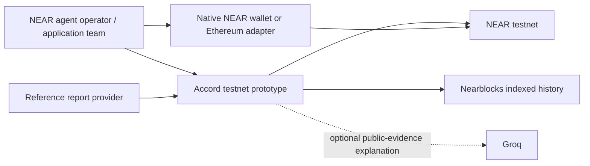
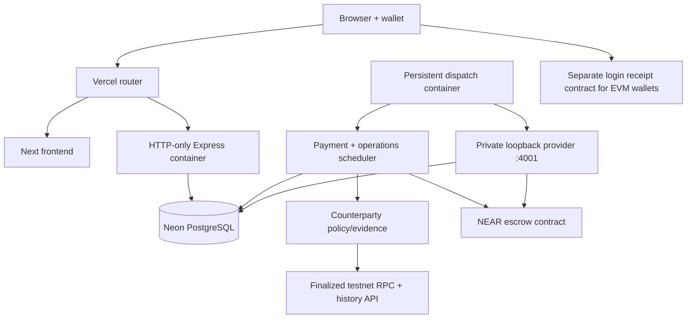
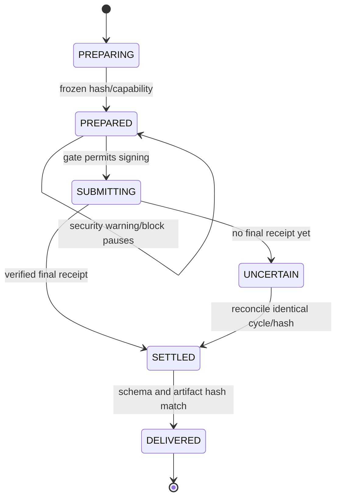

# Accord: project context, architecture and submission audit

**14 November creator MVP:** Approved external creators can now list their own hosted report service with a custom bounded input schema, per-provider signed protocol and the existing escrow/delivery flow. See [CREATOR_SERVICES.md](CREATOR_SERVICES.md) for setup and judge testing. Actual API/PostgreSQL and two HTTP providers are tested against controlled chain fixtures; a new live external-creator payment walkthrough is not claimed. The change is pushed as source only; the hosted runtime remains on the restored release. This updates the earlier configured-provider-only listing limitation, without adding public code uploads or automatic creator approval.

**14 November local extension:** [reliability/FINAL.md](reliability/FINAL.md) is the current report for the new security, delivery and experimental AI work. Those commits were subsequently pushed; Vercel unexpectedly auto-deployed them, then the previous production release was restored and the Git trigger disconnected. See [publication status](reliability/PUBLISHING.md). The new runtime is not currently deployed; the dated deployed-baseline audit below remains historical context. Full AI acceptance is still blocked by semantic quality and missing human review.

**Audit date:** 12 November 2026. **Application snapshot reviewed:** `519f83e7257b59849054e9bb460c39b48051ed53`, public `neelpote/accord-near`, branch `main`. This document is the current handoff and documentation index. Historical plans and dated evidence remain useful, but they do not override this description of the running application.

**12 November verdict (superseded by the checkpoint below):** the native NEAR architecture is appropriate for the owner's testnet-only requirement and the Security track. The core security/payment path has real implementation and testnet evidence. It is not an independently audited production system, and the final hackathon submission package is incomplete. The adversarial-output demo proves signer refusal; it does not prove that an agent consumed a malicious prompt and changed its behavior. Do not call that stricter demonstration complete.

## Current checkpoint — 13 November 2026

The previous causal-demo and wallet-rerun gaps below are now superseded by actual execution: [live model captures](causal-agent-responses.json), [funded control + two blocked cases](causal-attack-proof.json), [native agreement 23](security-native-wallet-proof.json), [Ethereum agreement 28](security-evm-wallet-proof.json) and [independent finalized readback](security-journeys-readback.json). Both live browser runs passed; the reference planner is intentionally vulnerable, its same-task/tool-document causal comparison is genuine, and replay uses no additional inference. All six approved Groq requests are consumed.

The counterparty gate is still backend-enforced, bounded indexed history is still fallible, and third-party extension/device UI is not certified. Neither social posting nor the final application has been performed. See [SECURITY_WALKTHROUGH.md](SECURITY_WALKTHROUGH.md) for current video packaging and instructions. Dated observations below remain an audit trail; use this checkpoint for the latest evidence.

## 1. Whole-repository technical deep-dive

### Product, intended users and problem

Accord lets an owner buy a finite series of agent-service reports with contract-enforced payment terms. A worker uses a narrowly scoped key; the owner retains cancellation, key revocation and withdrawal. Before a new charge, a deterministic counterparty service checks the payment contract and economic provider, pauses warnings for owner approval and refuses blocks. A separate unbilled operations workspace monitors reviewed NEAR code/key baselines and exposes incident evidence. These are implemented surfaces, not evidence of product-market fit. [README](../README.md), [worker](../backend/src/near/worker.ts), [counterparty service](../backend/src/near/counterparty.ts), [operations guide](OPERATIONS.md).

The proposed initial user is a NEAR bot/agent operator or a small application team/maintenance agency. Their concrete jobs are limiting delegated service spending, reviewing unexpected counterparties and investigating changes to deployed accounts. Ordinary token holders are not the validated target. The buyer is provisionally the engineering lead, founder or agency owner. No customer interviews, paid pilot demand or independently verified revenue have been established. Existing self-reported feedback and synthetic fixture wallets do not establish adoption. [Pilot discovery](pilot/INTERVIEWS.md), [measurement](pilot/MEASUREMENT.md), [pilot validation](../backend/src/near/pilot.ts).

The useful differentiator is the combination of exact recurring commercial limits, receipt-bound artifacts, explicit counterparty decisions and direct wallet exit. It is a defensible engineering distinction, not a proven commercial moat. A general-purpose scam oracle, arbitrary cross-chain payment router or autonomous investment manager is not implemented. [Contract](../contracts-near/src/lib.rs), [security policy](../backend/src/near/counterparty-policy.ts), [product alternatives](HACKATHON_DIFFERENTIATION.md).

### Detected stack

| Layer | Actual technology | Source |
| --- | --- | --- |
| Web | Next.js 16.4.6, React 19.2.4, TypeScript, App Router | [frontend/package.json](../frontend/package.json), [app entry](../frontend/app/page.tsx) |
| Wallets | NEAR Connect 0.12.0, near-api-js 7.4.0, native NEP-413; optional NEP-518 Ethereum adapter | [near.ts](../frontend/lib/near.ts), [wallet-auth.ts](../frontend/lib/wallet-auth.ts), [EVM auth](../backend/src/near/evm-auth.ts) |
| Interface motion | Three.js 0.187, credited Robot Expressive model, native-scroll choreography and CSS | [AgentScene](../frontend/components/AgentScene.tsx), [AgentExperience](../frontend/components/AgentExperience.tsx), [asset notices](../frontend/public/models/README.md) |
| API and scheduling | Node 24.22.2, TypeScript through tsx, Express 4, pg | [backend/package.json](../backend/package.json), [server](../backend/src/near/server.ts) |
| Payment contract | Rust 2024 edition, minimum Rust 1.95, near-sdk 5.30.1 | [Cargo.toml](../contracts-near/Cargo.toml), [contract](../contracts-near/src/lib.rs) |
| Login contract | Separate Rust/near-sdk stateless contract | [auth Cargo.toml](../contracts-auth/Cargo.toml), [auth contract](../contracts-auth/src/lib.rs) |
| Storage | PostgreSQL 17 locally/CI; managed Neon PostgreSQL hosted | [Compose](../docker-compose.yml), [schema](../backend/src/near/db.ts), [migration evidence](hosting-migration-proof.json) |
| Optional inference | Groq public-evidence explanations; NEAR AI Cloud adapter paused | [Groq](GROQ.md), [NEAR AI status](NEAR_AI_STATUS.md) |
| Hosting | Vercel web + container API + persistent worker/provider daemon; Neon durable database | [vercel.json](../vercel.json), [supervisor](../backend/scripts/hosted-worker.mjs), [hosting](HOSTING_AND_SUBMISSION.md) |
| Inactive baseline | Solidity/Arbitrum, original EVM workers and earlier frontend | [provenance](../PROVENANCE.md), [legacy deployment](../legacy/docker-compose.evm.yml) |

### Entry points and directory map

- `frontend/app/page.tsx`: active one-page app: wallet, terms, service directory, agreements and exit. `frontend/components/CounterpartySecurity.tsx` and `OperationsWorkspace.tsx` provide security and monitoring UI. Historical routes and wallet mocks under `frontend/legacy/` are inactive.
- `backend/src/near/server.ts`: active HTTP server, session ownership, catalog, agreement activation/history and local worker loops. `hosted-api.ts` disables loops for scalable hosted HTTP instances.
- `backend/src/near/provider-server.ts`: independent report preparation/release process. Its private endpoint reads actual receipts before releasing artifacts.
- `backend/src/near/worker.ts`: per-agreement payment/recovery loop. `operations-worker.ts` separately schedules unbilled monitoring and notification delivery.
- `contracts-near/`: deployed financial contract, tests, locks and WASM build. `contracts-auth/`: separate Ethereum-wallet login receipt contract.
- `backend/src/near/counterparty*`: policy, RPC/indexer evidence, persisted decisions, report moderation, HTTP routes and security acceptance scripts.
- `docs/`: current architecture/operations/security guides and dated evidence. `docs/design/` holds visual decisions; `docs/pilot/` holds honest discovery status; `docs/vendor/near/` holds cached reference material with its source manifest.
- `scripts/`: credential-format scanner and opt-in Ethereum-wallet fixture harness. `.agents/skills/`: installed Loops workflows. Tool installation does not mean an external evaluation was passed.
- `contracts/`, `agents/`, original `backend/src/api`, `backend/src/executor` and `backend/src/index.ts`: retained upstream context. Default startup does not run that EVM financial stack.
- Ignored `.tools`, `.near-credentials`, environment files, traces and backups are local operational material. They must not be copied into a public context document. A clean clone does not include these fixtures or private configuration.

### Commands and verification inventory

Run commands in the stated directory. Install backend/frontend dependencies with their lockfiles using `npm ci`. [Manifests](../backend/package.json), [frontend manifest](../frontend/package.json), [README setup](../README.md).

| Directory | Command | Purpose / qualification |
| --- | --- | --- |
| root | `docker compose up -d postgres` | Local PostgreSQL only; loopback port 55432 |
| backend | `npm run db:migrate` | Additive active schema, not legacy destructive migration |
| backend | `npm start` / `npm run near:dev` | Local API + awaited worker/operations loops unless disabled |
| backend | `npm run near:provider` | Separate provider on loopback 4001 |
| frontend | `npm run dev` | Development site, normally port 3000 |
| frontend | `npm run build && npm start` | Production build/server; configure API origin at build time |
| backend/frontend | `npm run typecheck` | TypeScript checks in each package |
| backend | `npm run near:test` | All `src/near/*.test.ts`; 23 tests in reviewed release |
| backend | `node --import tsx --test src/near/counterparty-policy.test.ts` | One focused policy test file |
| backend | `npm run near:test:security` | Isolated PostgreSQL + HTTP gate/approval/moderation tests; no chain writes |
| backend | `npm run near:test:operations` / `npm run near:test:evm-auth` | Isolated integration checks; fixture identity/RPC boundaries are disclosed |
| frontend | `npm run test:browser` | Nine presentation/auth/security-control tests, not all live funds tests |
| frontend | `node --test tests/deployment.test.mjs` | Four deployment/rewrite guard checks |
| contracts-near / contracts-auth | `cargo test --locked --lib` | Rust unit tests for the selected crate |
| same | `cargo fmt --check`; `cargo clippy --locked --all-targets -- -D warnings` | Formatting / strict Rust checks |
| same | `cargo near build non-reproducible-wasm --locked --no-abi` | Official cargo-near WASM build; not reproducible-build verification |
| contracts-near | `cargo test --locked --test test_basics` | Actual local Sandbox WASM integration |
| backend | `npm run near:demo:attack` | Real finalized read evidence + isolated denied-output fixture; no signing key or transfer |
| backend | `ACCORD_SECURITY_LIVE=1 npm run near:proof:security` | Funded dedicated-owner-fixture acceptance; requires ignored private fixtures and API 4400/provider 4001 |
| backend | `npm run near:proof:testnet` | Opt-in original two-cycle funded proof using dedicated developer fixtures |
| frontend | `npm run test:agent-wallet` | Opt-in real native wallet-fixture flow; warning approval now explicitly included |
| root | `ACCORD_EVM_LIVE=1 ACCORD_EVM_FULL=1 node --import ./backend/node_modules/tsx/dist/loader.mjs scripts/evm-wallet-proof.mts` | Opt-in real relayer fixture; requires locally prepared upstream adapter source/manifest and ignored EVM fixture |
| root | `python3 scripts/scan-secrets.py` | Recognizable credential-format scan; not a guarantee of no secrets |
| backend/frontend | `npm audit` | Current registry advisory check; CI backend fails at moderate, frontend uses its configured default |

There is no general application lint or formatting script in the package manifests. Do not invent one. Rust formatting is an explicit gate. The Ethereum fixture runtime command is based on the installed tsx loader path; consult [Ethereum setup](ETHEREUM_WALLETS.md) before using it. Live commands spend testnet tokens and must never target a customer's wallet or run implicitly as a documentation check.

[Application CI](../.github/workflows/application.yml) runs on pushes and PRs. [Contract CI](../.github/workflows/contract.yml) is path-scoped and covers both Rust crates. **CI runs, but branch `main` is not protected:** GitHub's branch-protection API returned “Branch not protected” during this audit. Passing checks therefore do not enforce pre-push review or block a direct push. No repository protection setting was changed.

### Deployment and runtime surface

| Surface | Pin / operational behavior | Evidence |
| --- | --- | --- |
| `.nvmrc` | Node 24.22.2 | [file](../.nvmrc) |
| Both npm packages | engines `>=24 <25` | package manifests above |
| Backend Docker stages | `node:24.22.2-bookworm-slim`; explicit hosted API/worker entrypoints | [Dockerfile](../backend/Dockerfile) |
| Frontend Docker build/run | Same Node base, API origin embedded at build | [Dockerfile](../frontend/Dockerfile) |
| Local and CI DB | `postgres:17-alpine` | Compose / application workflow |
| CI build runner | Ubuntu 24.04; Node 24.22.2 | application workflow |
| Rust toolchain | `stable`, minimum package Rust 1.95, WASM target | [toolchain](../contracts-near/rust-toolchain.toml), Cargo manifests |
| Rust build helper | cargo-near 0.23.0 installed with checksum verification | contract workflow |
| Cargo reproducible-build metadata | Template references cargo-near 0.22.0/Rust 1.99.1 image; not the verified host-build toolchain | Cargo manifests; do not present template metadata as an achieved reproducible build |
| Vercel routing | `/api/near/*` to container API; other routes to Next | [root config](../vercel.json) |
| Hosted API | HTTP-only, no scheduler; secure same-origin cookie session | [entry](../backend/src/near/hosted-api.ts) |
| Persistent daemon | Provider 4001 + scheduler/operations HTTP 4000; direct unpooled DB for session locks | [supervisor](../backend/scripts/hosted-worker.mjs) |
| Hosted DB | Neon free-tier migration verified; current provider engine maintenance is managed externally | [migration proof](hosting-migration-proof.json) |

Runtime/lifecycle EOL status and all upstream maintenance guarantees are **[UNVERIFIED]** by this local audit. Version pins and passing advisory thresholds do not establish long-term support. Inactive EVM dependencies are not evidence of active NEAR features. Avoid upgrading runtimes or running legacy migrations just to improve a checklist.

### Public deployment and fixture identifiers

| Component | Identifier / recorded evidence |
| --- | --- |
| Hosted application | https://accord-near-ten.vercel.app |
| Escrow | `contract.accord-dev-261110.testnet`; code hash `DfcbJBckRVsGXr1v6QARgrZthYDJ1EviULqYWaokLUTX` |
| Original escrow deployment | `ANvufY2wASqigzqbHXRYuYj5YSXgycmMA6uQp4ti9Wap` |
| Separate EVM login contract | `login.accord-dev-261110.testnet`; code hash `GX7CRevc8AW5pY1LxcWepKMrGpz6Tr51usCh62gbjRgz` |
| Login deployment | `9HXDNoVyaYmUf5z4q1g69S899t3cGT9Ep3fFhLqCMi49` |
| Reference provider | `provider.accord-dev-261110.testnet` |
| Dedicated native owner fixture | `buyer.accord-dev-261110.testnet`; private fixture is ignored and not part of a clean clone |
| Deterministic catalog | Wallet Watch `2`, Access Guard `3`, Contract Sentinel `4`, Receipt Inspector `5`, Network Pulse `6` |
| Optional Groq offer | Network Pulse Copilot `7`; availability depends on configured key and remaining persistent cap |
| Latest financial security proofs | Local agreement `21` and hosted agreement `22`, canceled and delegated key removed |
| Ethereum payment proof | Agreement `20`, canceled/key removed; predates the latest security warning extension |

These are recorded public testnet identifiers, not instructions to reuse private operator accounts. Deployment hashes are recorded in [testnet evidence](testnet-proof.json) and [auth deployment](evm-auth-deployment.json); catalog IDs and behavior are described in [agent services](AGENT_SERVICES.md). No contract was redeployed by the counterparty feature or this audit. Confirm current code before signing: retained upgrade authority means an old hash is not an immutability guarantee.

### Storage, jobs and API boundaries

On-chain storage is the authority for service terms, prepaid reserves, billing cycle, cancellation, receipt and withdrawal ledgers. PostgreSQL persists sessions, catalog metadata, encrypted delegate keys, prepared artifacts and delivery/recovery state. The contract alone cannot recreate lost provider artifacts or the encryption key. [Financial state](../contracts-near/src/lib.rs), [schema](../backend/src/near/db.ts).

The active schema additionally contains wallet-owned workspaces/baselines, incidents, timeline events, notifications/outbox leases, linked paid reports, pilot feedback, inference counters and synthetic demo records. Security tables hold observations, owner-reviewed code identities, shared reports/reviews and exact-payment decisions. They are application records, not decentralized attestations. [Schema](../backend/src/near/db.ts).

The HTTP API prefixes `/api/near` only in the hosted wrapper; local Express routes are unprefixed. Top-level Vercel routing preserves the original hosted path. Owner-only routes obtain identity from the session, never an account field supplied by the browser. The provider address is operator-configured; arbitrary user URLs are not fetched. [server](../backend/src/near/server.ts), [routing](../vercel.json), [provider](../backend/src/near/provider-server.ts).

## 2. Context, decisions and documentation authority

### Identity and provenance

| Item | Verified value |
| --- | --- |
| Repository | https://github.com/neelpote/accord-near |
| Branch / reviewed HEAD | `main` / `519f83e7257b59849054e9bb460c39b48051ed53` |
| Visibility | Public, confirmed through GitHub API during audit |
| License | Root MIT grant plus preserved third-party notices; GitHub classifier returned `NOASSERTION`, not a legal determination |
| Upstream | `web3cook/Daemon`, baseline `2eeed81fc3cec1dafbd277f2dccea8909247455d` |
| New work boundary | `upstream-baseline...main` diff; NEAR work during the build window |
| Reuse authorization | Owner confirmed reuse/republication; truthful provenance retained |

[Provenance](../PROVENANCE.md), [license](../LICENSE), [baseline diff](https://github.com/neelpote/accord-near/compare/upstream-baseline...main).

### Standing owner decisions

- Project name Accord; public repository under `neelpote`; incremental tested commits/pushes authorized.
- Testnet only. No mainnet transactions, credit purchases or paid infrastructure upgrades are authorized.
- Implement full testnet Ethereum-wallet support while preserving native login; keep the different authentication mechanisms explicit.
- Preserve existing source rights/notices and distinguish baseline work from new NEAR contributions.
- NEAR AI Cloud generation remains paused. Groq is optional and budget-limited; no additional inference was needed for the security release/audit.
- Ask about consequential product/security/financial choices instead of inventing user approval. Do not submit the final application or publish social posts on the owner's behalf without explicit approval of actual content.
- Loops evaluation returns a prompt for an agent-run review; it is not an external judge's approval. MiroFish is installed separately as a research tool; no simulation or actual customer interviews have been completed by this build.

Evidence: [decisions](../DECISIONS.md), [provenance](../PROVENANCE.md), [hosting/submission](HOSTING_AND_SUBMISSION.md), [AI status](NEAR_AI_STATUS.md), [Groq](GROQ.md), [MiroFish brief](pilot/MIROFISH_BRIEF.md), [Loops gate](evaluations/COUNTERPARTY_SECURITY_GATE.md).

### Documentation index and supersession

| Read for | Authoritative current file |
| --- | --- |
| Full project context and this audit | This document |
| Judge quickstart, problem and try-it steps | [README](../README.md) |
| Component/payment overview | [Architecture](ARCHITECTURE.md) |
| Counterparty policy, sources, API and limits | [Counterparty security](COUNTERPARTY_SECURITY.md) |
| Operational workspace / notifications / evidence | [Operations](OPERATIONS.md) |
| Agent catalog and real report examples | [Agent services](AGENT_SERVICES.md) |
| Wallet adapter and authentication | [Ethereum wallets](ETHEREUM_WALLETS.md) |
| Hosting, cutoff and final submission requirements | [Hosting/submission](HOSTING_AND_SUBMISSION.md) |
| Current checks plus historical checkpoints | [Verification](../VERIFICATION.md) |
| Security engineering review and limits | [Security review](SECURITY_REVIEW.md) |
| Current security-demo storyboard / packaging | [Demo](DEMO.md) |
| User discovery and pricing uncertainty | [Pilot](pilot/INTERVIEWS.md), [measurement](pilot/MEASUREMENT.md) |
| Changes delivered in the earlier five phases | [Phase delivery](PHASE_DELIVERY.md) |

`PRD.md`, `whitepaper.md`, `frontend/API_SPEC.md`, `backend/BACKEND_CHANGES.md` and earlier module READMEs contain upstream EVM proposals. `DAEMON_NEAR_*` files contain superseded Agent API-first alternatives. They are labeled historical; never use them as the active deployment spec. Dated proof JSON/video records establish only the commit/scope described inside them. An older successful video is not proof that the latest security UI was recorded. A document cannot contain literally every future state: refresh this file when behavior/topology changes.

The only current repo-specific frontend instruction file is [frontend/AGENTS.md](../frontend/AGENTS.md): read bundled Next documentation before editing framework behavior. The installed skills are workflow instructions, not application runtime dependencies. The owner's separate Resolve instructions apply only to Resolve editing; no Resolve project was touched in this audit.

### Why this approach, and why not the alternatives?

1. **Native contract for financial limits:** on-chain price/provider/cycle/interval/expiry checks protect against a malicious dispatcher, rather than relying on a backend timer. The cost is prepaid custody, native-NEAR pricing, retained storage and upgrade trust. [Contract](../contracts-near/src/lib.rs).
2. **Function-call key instead of full access:** the agent can invoke only `charge` on one contract with finite gas authority. Owner setup/exit uses separate wallet authority. A function-call key cannot itself transfer native NEAR or attach a deposit, so the payment is a credit from already-funded contract reserves. [Worker](../backend/src/near/worker.ts), [NEAR access keys](https://docs.near.org/protocol/accounts-contracts/access-keys).
3. **Backend counterparty policy:** easiest way to review live RPC/history and shared reports without another deployed financial contract. It protects the normal worker, not a compromised backend holding the delegate. Contract-enforced security attestations are a stronger alternative that is not implemented. [Security service](../backend/src/near/counterparty.ts).
4. **Agent API/Intents excluded from this testnet path:** current Agent API documentation still states mainnet-only beta. The owner forbids mainnet execution. This is a valid scope choice, not a claim that native escrow is universally better. [Official Agent API overview](https://docs.agentsonintents.com/integration/agent-api/overview).
5. **Recurring agreement rather than only x402:** finite advance authorization and exact recurring limits are the product behavior. Per-request HTTP payment may be simpler for occasional requests; no claim that subscriptions are always preferable. [Architecture](ARCHITECTURE.md).
6. **Unbilled monitoring pilot:** test whether the operator workflow solves a real recurring need before pretending every observation is monetizable. The product currently spans two related jobs; customer discovery must determine whether security spending or application monitoring is the primary product. [Pilot](pilot/INTERVIEWS.md).

## 3. Architectural blueprint

### System context



### Containers and deployment



### Representative request and decision lifecycle

```mermaid
sequenceDiagram
  participant O as Owner wallet
  participant API
  participant W as Worker
  participant SEC as Counterparty service
  participant P as Provider
  participant C as NEAR escrow
  O->>API: Authenticate; establish wallet-owned session
  O->>C: Fund fixed agreement and add charge-only key
  API->>C: Verify finalized terms/key/input
  W->>P: Prepare frozen artifact
  W->>SEC: Exact intent + provider from on-chain service
  SEC-->>W: allow / warn / block + evidence
  alt warn
    SEC-->>O: Review one exact payment (five minutes)
    O->>API: Approve bound intent/evidence hashes
    W->>SEC: Refresh evidence; consume approval once
  else block
    SEC-->>W: Refuse signature
  end
  W->>C: Authorized zero-deposit charge only
  P->>C: Verify exact final receipt
  P-->>W: Release matching report
  O->>C: Cancel / remove key / withdraw separately
```

### Layering and cross-cutting concerns

The client holds wallet UI/public data and session cookies; it cannot supply trusted payment receipts or signing keys. The API validates owner and finalized chain terms. The worker obtains expected price/provider from the service, while the contract independently enforces money rules. The provider independently verifies settlement before delivery. Shared modules express these rules; TypeScript, tests and explicit route ownership enforce parts of the boundary. There is no architecture linter or independently enforced deployment attestation. [server](../backend/src/near/server.ts), [worker](../backend/src/near/worker.ts), [provider](../backend/src/near/provider-server.ts).

| Concern | Actual mechanism / location | Limit |
| --- | --- | --- |
| Authentication | NEP-413 session; browser-bound EVM login receipts | External wallet UI not fully certified |
| Authorization | Session owner queries; scoped key; contract signer/key and terms checks | Deployer retains upgrade authority |
| CSRF / browser boundary | Strict Origin checks and HttpOnly SameSite cookie | Stable public origin must be configured correctly |
| Secrets | Server env, encrypted delegate at rest, ignored fixtures | DB + encryption-key compromise exposes delegate authority |
| Configuration | `config.ts`, `.env.example`, network check | Trusted RPC/provider/operator config remains necessary |
| Artifact integrity | Canonical SHA-256, persisted preparation capability, receipt hash binding | Hash does not prove quality or meaningful work |
| Logs / errors | Bounded diagnostics, last_error, timeline, notification records | No production tracing/SLA is established |
| Health | `/health`, `/ready`, persistent worker heartbeat | A momentary 200 does not prove uptime |
| Feature flags | AI enable/caps, optional EVM auth config, local worker flags | Production money path has no security-gate bypass switch |
| Recovery | Same cycle/hash, durable receipt/artifact state, advisory locks | Must preserve database, artifacts and encryption key |

### Deep-dive A: recurring settlement and recovery

A service binds provider, price, interval and metadata hash. A subscription additionally binds owner, delegate key, input hash, max cycles, expiry, next due time and reserve. `charge` derives financial recipient/amount internally; caller arguments are only subscription, cycle and artifact hash. Duplicate same-cycle/hash calls return the original receipt. Early, expired, wrong-key, exhausted and mismatched-hash calls fail. Cancellation releases unused reserves, while callback-checked withdrawals debit before transfer and restore failed payouts. [Contract methods](../contracts-near/src/lib.rs).



Only one unresolved cycle per agreement is permitted in PostgreSQL. Session advisory locks serialize live workers and require an unpooled connection. Already-paid delivery recovery does not require another security authorization or another payment. A timeout is not proof of nonpayment. The provider also persists optional inference preparation before making a possibly billable call and does not silently regenerate an exposed artifact. [Worker](../backend/src/near/worker.ts), [provider](../backend/src/near/provider-server.ts), [recovery proof](recovery-proof.json).

### Deep-dive B: counterparty policy and human approval

At one finalized block the service reads escrow/provider code identities. Nearblocks v3 supplies indexer-reported creation and the latest 25 transactions. Local observations detect code changes; immutable global contract hashes are supported, mutable global account references remain unresolved. Prior interaction is Accord's confirmed `(owner, provider)` receipt history. The shared registry is app-managed with authenticated reports, finalized evidence involvement and explicit curator decisions. [Sources](../backend/src/near/counterparty-sources.ts), [service](../backend/src/near/counterparty.ts), [policy](../backend/src/near/counterparty-policy.ts).

A block refuses signing. A warning binds exact network/agent/contract/receiver/method/amount/cycle/artifact plus code/report/policy evidence, expires in five minutes and needs owner approval. Evidence is refreshed before one-use consumption; missing fresh RPC state cannot be overridden. Reviewed code identities are separate from mere observations. New low-trust reports warn; they do not automatically establish maliciousness. The actual private key is decrypted only inside the permitted callback. [Gate](../backend/src/near/counterparty.ts), [worker](../backend/src/near/worker.ts).

**Residual risks:** latest-25 activity is not a full historical index; observations do not prove exact deployment time; the default young-account rule can require repeated manual approvals on new testnet providers; Sybil reports can create review burden; curators are trusted; and a compromised dispatcher can bypass this off-chain gate while still being constrained by contract financial terms. No numeric safety probability or guaranteed scam detection is justified. [Security limits](COUNTERPARTY_SECURITY.md).

At the 12 November audit, the original attack script created an isolated deny fixture and directly supplied a malicious intent. It contains an injected-looking document but does not run a model/agent over it. Its hardcoded agreement context also does not establish an otherwise valid charge attempt. **Evidence strength: signer-boundary adversarial test, not a complete causal prompt-injection demonstration.** A stronger demo should feed a controlled malicious tool response into an agent, capture its proposed action, show an unblocked valid control, then show the same applicable proposal denied before signing. No live inference budget is expanded merely to make this claim. [Attack source](../backend/src/near/counterparty-attack.ts), [captured log](counterparty-attack-proof.json).

### Deep-dive C: authentication and application operations

Native login uses one-use challenges and NEP-413 verification. EVM accounts cannot use that interface, so a separate stateless login contract emits a challenge/audience/owner event. The backend requires the initiating browser cookie, finalized transaction/receipt identity, code pin at the execution block and atomic challenge consumption. A public chain transaction alone is insufficient login proof. The relayer engine has actual testnet execution evidence; that does not certify every MetaMask extension/mobile interaction. [Wallet auth](../frontend/lib/wallet-auth.ts), [EVM verifier](../backend/src/near/evm-auth.ts), [login contract](../contracts-auth/src/lib.rs), [proof](evm-wallet-proof.json).

The independent operations workflow captures an owned workspace's accounts at one block, proposes/reviews exact baseline hashes and compares code/key authority shapes. Repeated changes group into incidents; resolved conditions can reopen. A durable outbox delivers in-app or operator-configured signed webhooks, with bounded retries/leases. Acknowledgement is distinct from external delivery. Evidence exports normalize dates before hashing and expose truncation. Optional explanations never alter deterministic facts or sign actions. [workspaces](../backend/src/near/workspaces.ts), [incidents](../backend/src/near/incidents.ts), [notifications](../backend/src/near/notifications.ts), [exports](../backend/src/near/evidence.ts).

### Adding a feature safely

Trace the real caller and money/auth boundary first. Use current `backend/src/near` code, not the upstream API spec. Extend the input validator and artifact schema when adding an agent; keep service metadata hashes compatible with immutable on-chain registrations. Add an isolated check for nontrivial authorization/financial branches. Frontend mocks must return the actual response shape. Test warning approval through the UI rather than removing policy checks. Build/types/CI should pass before publishing a claim. Any new mainnet action, budget increase, broad key or on-chain security authorization requires a consequential design decision, not a documentation assumption.

## 4. Fresh security-track and submission audit

### Official sources reread

- [Organizer HACKATHON.md](https://nearhackathon.com/HACKATHON.md), reread 12 November 2026: testnet eligibility, native-contract eligibility, example-vs-requirement distinction, baseline disclosure and final submission procedure.
- [Security track prompt](https://github.com/nearai/near-hackathon-prompt-examples/blob/main/tracks/06-security.md): the counterparty-check example the owner explicitly chose to implement.
- [Official event page](https://nearhackathon.com/): security build direction and repository/demo submission flow.
- [NEAR access-key documentation](https://docs.near.org/protocol/accounts-contracts/access-keys): restricted contract/method/gas authority and recovery caveats.
- [Agent API overview](https://docs.agentsonintents.com/integration/agent-api/overview): still mainnet-only beta at this check.

The organizer guide allows testnet-only entries and says suggested protocols/example prompts are not mandatory integrations. Existing baselines are allowed when the new work is separated and disclosed. Our chosen native financial contract therefore fits the entry conditions without claiming Agent API or TEE. The owner separately requested the counterparty example, so its acceptance criteria remain project commitments. Deadline: **14 November 2026, 23:59 UTC / 15 November, 05:29 IST**. The final package needs a public repository, public human-posted demo and accurate application details/consent before one confirmed submission. These are source-based entry rules, not a win prediction.

### Delivered versus the chosen example

| Example requirement | What is delivered | Audit assessment |
| --- | --- | --- |
| `allow/warn/block` plus reasons | Policy/service persisted and used by actual payment worker | Implemented, with deterministic heuristics |
| Age/activity | Nearblocks v3 creation and recent 25 transactions | Implemented with bounded coverage, not lifetime reputation |
| Contract / recent code change | Finalized effective hash, observation comparison, recent indexed deploy actions | Implemented with polling/window limitations |
| Prior interaction | Confirmed Accord owner/provider receipts | Implemented for this application, not full ecosystem history |
| Shared evidence blocklist | Authenticated reports, RPC evidence, explicit curator review and audit history | Implemented, centrally curated |
| Block refuses signature | Mandatory worker gate before key decryption | Verified in policy/integration checks |
| Warn asks a human | Exact-payment authenticated approval UI, expiry, recheck and atomic consumption | Verified through hosted agreement 22 |
| Agent key restricted to one contract | `charge` only, finite gas; contract enforces financial limits | Implemented; owner/admin setup keys are separate |
| Explain key limits in README | README and security guide distinguish gas from payment budget and direct exit | Implemented |
| Prompt-injected agent attack + log | Direct malicious-intent fixture and real state reads, zero signing calls | **Partial against the literal example**; no agent actually consumes the malicious prompt |

### Current evidence and verification

| Evidence | What it supports | What it does not support |
| --- | --- | --- |
| [Application CI 43243745816](https://github.com/neelpote/accord-near/actions/runs/43243745816) | Reviewed HEAD passed installs/types/unit/integration/schema/audit/build/browser/scanner gates | Independent security certification or full live-wallet vendor testing |
| [Contract CI 43180728469](https://github.com/neelpote/accord-near/actions/runs/43180728469) | Both current Rust crates passed their path-scoped contract workflow; escrow Sandbox included | Reproducible build, live adversarial network proof or immutable admin |
| [Local security acceptance](counterparty-live-proof.json) | Agreement 21: warning, approval, one charge/report, finalized cancellation/key removal | Real customer or paid demand |
| [Hosted security acceptance](counterparty-hosted-proof.json) | Agreement 22: actual browser approval, paid receipt/report hash, owner isolation, curator auth and cleanup | Third-party wallet popup certification |
| [Attack log](counterparty-attack-proof.json) | Real source reads and refusal before signer callback for an injected malicious intent | End-to-end prompt-injected model/agent behavior |
| [EVM proof](evm-wallet-proof.json) | Real NEP-518 relayer payment/exit before the latest security extension | A rerun of that complete flow with the new warning gate |
| [Pilot notes](pilot/INTERVIEWS.md) | Zero conducted interviews and explicit discovery gate | Customer demand, revenue or willingness to pay |

Fresh hosted checks: `/health` and `/ready` both returned HTTP 200/testnet after a first 15-second readiness request timed out. Record that transient failure rather than asserting continuous availability. No new inference, mainnet transaction or funded acceptance was performed solely for this documentation audit.

### Remaining work before an unqualified submission-ready claim

1. **Completed 13 November: causal attack/control demonstration.** Actual captures, funded control agreement 31 and blocked agreement 32 resolve the original 12 November gap. The deliberately vulnerable reference planner is separate from the production deterministic worker.
2. **Security walkthrough:** see the current film and review in SECURITY_WALKTHROUGH.md. Historical brief: show a concrete payment proposal, evidence, warning approval, resulting receipt/report and denied attack. Existing videos of older portfolio/monitoring flows are historical assets, not the latest security demo. A concise storyline is stronger than adding another unrelated feature.
3. **Completed 13 November: updated native/EVM opt-in harness reruns.** Historical requirement: This audit updates the test scripts to explicitly approve warnings. Typechecking those edits is not a funded rerun or real MetaMask-device certification.
4. **Verify reproducibility from a genuinely fresh environment:** CI proves clean dependency installs and isolated tests. Full funded reproduction additionally needs dedicated testnet accounts, catalog/provider setup and ignored local fixtures. The hardcoded security acceptance script is a developer-fixture proof, not a turnkey arbitrary-wallet demo. Adapt fixture IDs explicitly before generalizing that claim.
5. **Prepare final human-owned submission assets and details:** public X demo URL, final track selection, lead/contact/team size, payout account, consent and exact payload approval. No submitted application receipt is recorded by this implementation. Do not confuse a deployed URL or Loops prompt with a saved entry.
6. **Maintain availability through judging:** verify Vercel/Neon quotas and a fresh public health/demo read near submission. A free hosted demo has resource limits and no established SLA. Do not provision paid resources automatically.

Real customer interviews are strongly recommended to validate usefulness and the repeated-warning burden, but are not listed here as mandatory track eligibility. Do not withhold an otherwise valid entry merely because no customer revenue exists; also do not claim that technical fit means it is likely to win.

## Confidence assessment

| Claim area | Confidence | Reason |
| --- | --- | --- |
| Native testnet approach fits published track eligibility | High | Fresh official guide and track read |
| Payment restrictions, wrapper and one-use warning flow exist | High | Source + isolated tests + prior real hosted receipts |
| No possible financial/security bug | Unverified / not claimed | Tests and this source audit are not a proof of absence |
| Prompt-injection demo literally complete | Completed engineering checkpoint, 13 November | Actual model captures, funded control and blocked proposals are linked at the current checkpoint; not a general immunity claim |
| General scam detection and full-chain reputation | Not implemented | Bounded indexer window and curated app registry |
| Current third-party wallet UI behavior | Partial | Actual protocol engine proofs, incomplete device certification |
| Continuous public uptime | Unverified | Fresh 200s plus one timeout; no SLA |
| Customer value / commercial demand | Unverified | No completed discovery interviews |
| Final submission ready and saved | No | Demo packaging, human fields/consent and final send remain |

## Footnotes: primary local evidence

- [README](../README.md): intended product, setup, limitations and provenance.
- [Financial contract](../contracts-near/src/lib.rs): actual financial authority and recovery/exit.
- [Worker](../backend/src/near/worker.ts): lock, frozen artifact, mandatory security boundary and final receipt recovery.
- [Counterparty implementation](../backend/src/near/counterparty.ts): data collection, persisted authorization and moderation.
- [Policy](../backend/src/near/counterparty-policy.ts): exact decisions, fingerprints, freshness and refusal.
- [Evidence sources](../backend/src/near/counterparty-sources.ts): bounded history and finalized code identity.
- [API](../backend/src/near/server.ts): actual routes, owner sessions and batched agreement history.
- [Provider](../backend/src/near/provider-server.ts): preparation and actual receipt-backed release.
- [Authentication](../backend/src/near/evm-auth.ts): browser binding, receipt/code verification and one-use session creation.
- [Schema](../backend/src/near/db.ts): durable state and constraints.
- [Deployment](../vercel.json): active hosted topology; Docker/supervisor files define processes.
- [Application CI](../.github/workflows/application.yml), [contract CI](../.github/workflows/contract.yml): automated checks, with the enforcement distinction recorded above.
- [Security guide](COUNTERPARTY_SECURITY.md), [source review](SECURITY_REVIEW.md), [release evidence](counterparty-release-proof.json): supplementary checks and explicit limits.

## Local reliability extension — pending deployment

See [reliability/IMPLEMENTATION.md](reliability/IMPLEMENTATION.md) for the new phase audit, source changes and acceptance gates. Phase 1/2 local acceptance includes real testnet agreements 33/34 but does not mean the public API/provider has been rolled out. No production configuration or deployment changed. The new private protocol, additive schema and owner identity/specification consent require coordinated rollout.

Phase 3 implements one Risk Analyst on that same payment path, with a pinned free local model, bounded read-only finalized snapshots, exact previous-paid-baseline binding, strict evidence/schema checks, digest-only inference audit and explicit unverified narrative quality. The small initial model was rejected after semantic inspection despite JSON success. See [AI audit/evaluation](reliability/AI.md), [human review worksheet](reliability/ai-human-review.json), [Loops-prompt review](reliability/LOOPS_REVIEW.md) and [operating/rollback guide](reliability/OPERATIONS.md). No Groq allowance was renewed, NEAR AI Cloud remains paused, and no claim of human-reviewed accuracy, validated customer value or an independent audit is made.

Final local checkpoint (14 November): [FINAL.md](reliability/FINAL.md) is authoritative for this reliability extension. Agreement 35 completed recurring live local inference; agreement 38 completed the current native UI, including cancellation/key removal/exit. Actual failures and cleanup are retained rather than erased. The experimental offer, scheduler and model were disabled after testing. The 78 backend units, 13 browser regressions and all enumerated local checks passed, but human-reviewed AI correctness/usefulness, independent audit and production rollout remain unverified. At that pre-publication checkpoint, remote main was `24ead06044a946087213190c8722879771f70565`. The owner subsequently authorized ordered pushes; [PUBLISHING.md](reliability/PUBLISHING.md) records publication and CI follow-up.
