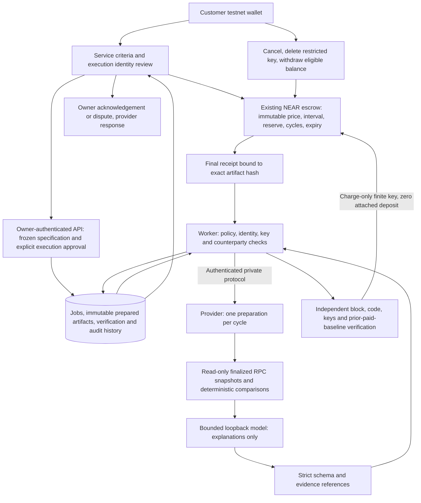

# Updated architecture and operating guide — unreleased local work

No production environment, contract deployment or remote repository was changed by these phases. Do not deploy this directory merely because tests pass. Human-labelled AI evaluation, deployment isolation and production rollout remain separate work.



## Data and contracts

`backend/src/near/db.ts:migrateExecution` contains idempotent additive migrations: service execution enablement; owner execution pause/approved identity/time; frozen delivery spec/hash; prepared envelope/provider attempts/payment reference/delivery timestamps; append-only execution/delivery/dispute records; local inference request ledger and digest-only inference audit. Existing financial and paid artifact rows are retained. Run migrations twice in staging to verify idempotence. Existing subscriptions require new explicit criteria/identity approval before new work; legacy already-paid output stays retrievable and is labelled as lacking new verification consent.

No Rust financial logic or deployed WASM changed. Rust additions are tests. The existing escrow remains the ultimate enforceable price/recipient/cadence/cycle/expiry/reserve boundary. It does not prove semantic quality, support arbitrary refund/clawback, attest worker integrity or cryptographically enforce backend evidence review. A fully compromised host/database/protocol-secret holder can bypass off-chain checks; the finite key still cannot transfer, withdraw or cancel. Stronger protection needs independently isolated credentials and verifiers, not another green badge.

## API additions

All owner/provider mutations require the existing signed wallet session and origin checks. Private provider calls require HMAC request **and response** binding, timestamp and canonical body. Public fields below contain no secrets.

| Route | Access | Meaning |
| --- | --- | --- |
| `GET /services/:id/execution` | Public | Advertised agent/provider/service/version/model/build/endpoint identity, enabled state, frozen-spec candidate and hashes |
| `POST /services/:id/execution` | Registered provider | `{enabled:boolean}`; disables future execution for that offer |
| `POST /subscriptions/:id/execution` | Agreement owner | `{paused:true}`, or `{approve:true,identity_hash,spec_hash}`; `{revoked:true}` requires finalized absent-key RPC readback |
| `GET /execution/jobs` | Owner | Only that owner's outstanding/paid jobs and bounded security events |
| `GET /subscriptions/:id/cycles/:cycle/verification` | Owner | Verification stages/history, receipt and dispute history |
| `POST /subscriptions/:id/cycles/:cycle/feedback` | Owner/provider | Owner `{action:"accept"}` or `{action:"dispute",reason}`; provider `{action:"respond",reason}` only after dispute. Does not alter money or self-resolve disputes |
| `GET /inference/status` | Public | Bounded request count and loopback model-list reachability; this is not an inference/accuracy/attestation guarantee. Unavailable Risk inputs are rejected before funding |
| `POST /prepare` on private provider | Protocol HMAC | Bound agreement/cycle/input/identity/spec; one preparation; returns report envelope for prepayment validation |
| `POST /deliver` on private provider | Protocol HMAC + chain receipt | Retrieve the exact paid artifact; no fresh inference or replacement report |

Risk service metadata uses `kind: near-contract-risk-analyst-v1`, `analysis_mode: local-llm` and the configured approved provider URL. Input: `{account_id,expected_code_hash}`. Account and hash validators are shared with the existing Sentinel. See `backend/src/near/service-delivery.ts` for versioned fields, deadlines and failure rules. Polling reports are historical observations, not continuous prevention or source-code audits.

## Reproduce locally

Use Node 24, PostgreSQL 17 and the existing dedicated **testnet** developer fixtures. Keep all `.env`, `.tools` and `.near-credentials` material out of Git. New private protocol value: `ACCORD_PROVIDER_SECRET`, randomly generated, at least 32 characters, shared only between API/worker/provider. It is not a customer key. Use the role environment launcher in `backend/scripts/execution-env.mjs`; do not pass the entire host environment to a model.

```sh
npm --prefix backend ci
npm --prefix frontend ci
docker compose up -d --wait postgres
cd backend
npm run db:migrate
npm run db:migrate
npm run typecheck
npm run near:test
npm run near:test:execution
npm run near:test:security
node --test scripts/execution-env.test.mjs
```

For **free local development inference on Apple Silicon**, use Python 3.12 and a venv; never install this into system Python. Allow roughly 3 GB for model bytes plus runtime dependencies. The following downloads only pinned data/tokenizer/weight files, no remote Python implementation:

```sh
uv venv ../.tools/risk-mlx-venv --python 3.12
uv pip install --python ../.tools/risk-mlx-venv/bin/python -r local-risk-requirements.txt
../.tools/risk-mlx-venv/bin/python scripts/local-risk-model.py download
../.tools/risk-mlx-venv/bin/python scripts/local-risk-model.py serve
```

Use `RISK_AI_ENABLED=true`, `RISK_LOCAL_MAX_REQUESTS=64`, `RISK_LOCAL_URL=http://127.0.0.1:4002/v1/chat/completions` **only in local development**. The ledger never resets on startup. Keep `GROQ_ENABLED=false` and `NEAR_AI_ENABLED=false` in this profile. Provider port4001, API4000, frontend3100. The existing API's `PUBLIC_ORIGIN` must match the browser origin exactly. Start provider and worker/API with role-specific credentials. Do not expose the MLX endpoint or use the development runtime as a hosted backend.

```sh
# Explicit local-only evaluation, no signing. Existing case results resume without inference duplication.
ACCORD_LOCAL_AI_EVALUATE=1 npm run near:evaluate:risk
# Backend crash recovery reuses a finalized receipt; no signing credentials are usable there.
ACCORD_RECOVERY_PROOF=docs/reliability/phase3-testnet.json ACCORD_DELIVERY_LIVE=1 npm run near:test:recovery
# Separate terminal, repository root:
ACCORD_BASE_URL=http://localhost:3100 npm --prefix frontend run test:browser -- --output=../.tools/playwright-regression
```

Live testnet proof is **opt-in**: `ACCORD_RISK_LIVE=1 ACCORD_EXECUTION_LIVE=1 ACCORD_DELIVERY_LIVE=1 npm run near:proof:testnet`. It creates finite fixture agreements and uses real faucet funds. It cancels/revokes keys on failure. Use a local supervisor and matching private protocol secret; the acceptance harness's private secret path is `.tools/reliability-provider-secret`. These developer proofs do not accept arbitrary customer credentials.

## Staging deployment and rollback plan — not executed

1. Export an encrypted database backup and record the deployed commit, schema and current paused jobs. Preserve paid artifacts and receipts.
2. Keep new signing/scheduling paused. Apply additive migrations, confirm they run twice, and provision a unique HMAC secret for all three roles. Use isolated provider/worker containers, non-public provider networking, outbound restrictions and separate credentials/database grants; environment filtering alone is insufficient.
3. Deploy compatible API/provider/worker/frontend together in staging. Rehearse existing paid artifact recovery, explicit owner spec/identity consent and actual key revocation. No schema drop, financial-contract redeploy or paid credit activation is required by this change.
4. Leave AI disabled unless a suitable hosted inference runtime, human-reviewed evaluation and operational budgets have been approved. This local model is not available to Vercel automatically. Run a canary on dedicated testnet fixtures, then inspect actual receipt/hash/delivery states before enabling new scheduling.
5. Do not roll an old unauthenticated/old-worker build back into active scheduling. On failure pause both worker and provider first, retain finalized receipts and exact prepared envelopes, disable affected offers and restore a compatible code version with scheduling off. Restore backups only in a separate recovery database; reconcile ledger/receipt IDs before any resumption. Reverting backend code cannot reverse finalized NEAR transactions.
6. Cancel/remove delegate keys through owner wallets where required, reconcile outstanding paid deliveries and process disputes manually. No automatic refund is promised. Resume only after the staging failure is understood and compatible criteria/identities have explicit owner approval.

Browser suites run in separate output directories when parallelized. Otherwise Playwright may remove another run's trace files during cleanup. Native acceptance uses `ACCORD_LIVE_BROWSER=1 ACCORD_RISK_WALLET=1 ACCORD_BASE_URL=http://localhost:3100 npx playwright test tests/live-wallet.spec.ts --output=../.tools/playwright-live-risk` from `frontend`. It uses only dedicated developer testnet fixtures and the standard NEAR Connect injection API; no key enters the page. Keep worker scheduling on only for that explicitly scoped fixture run, then stop it and disable the experimental risk offer.
